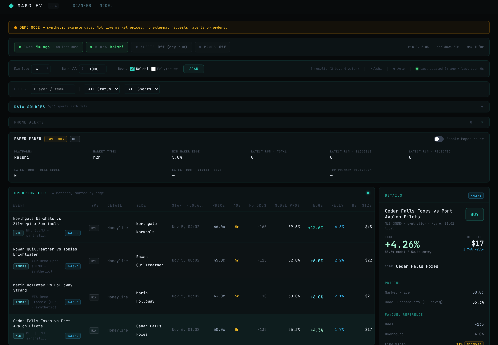
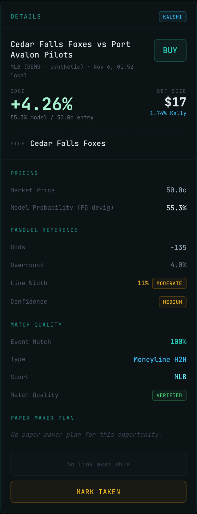
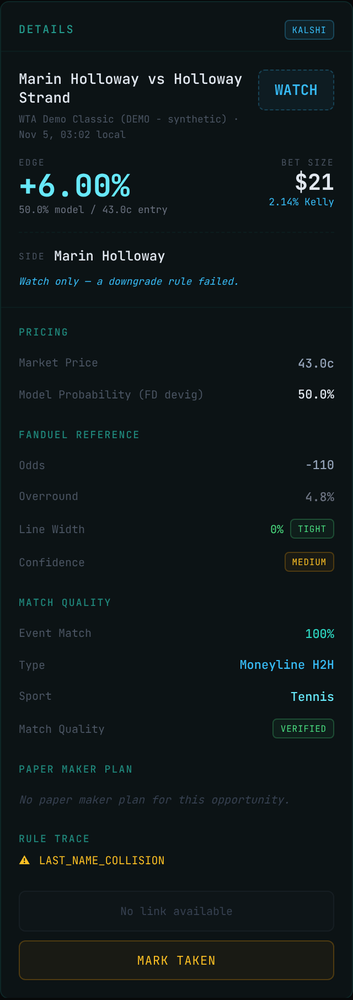
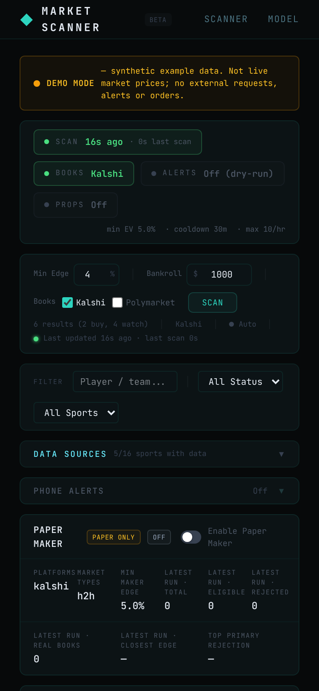
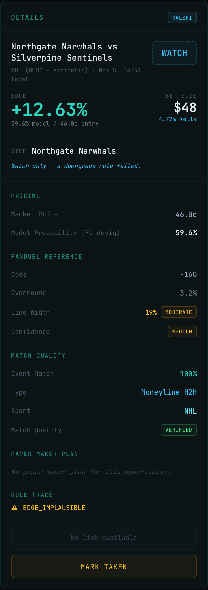
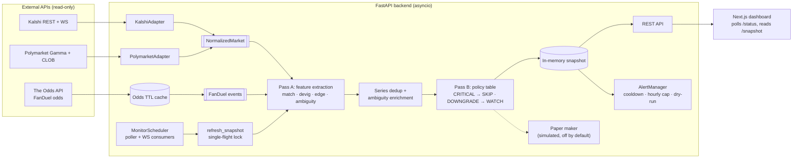

# MasG EV Tool

A cross-platform market-data analysis and monitoring system. It continuously
ingests prices from two prediction-market exchanges (**Kalshi** and
**Polymarket**), matches each market to the same real-world sporting event at a
sportsbook (**FanDuel**, via The Odds API), converts the sportsbook odds into a
vig-free model probability, and flags markets whose exchange price diverges from
that model estimate. Every flagged market carries a full, inspectable rule trace
explaining why it was classified **BUY**, **WATCH**, or **SKIP**.

The system is **read-only decision support**. It places no orders, holds no
wallet keys, and never submits anything to an exchange; acting on a result is
always a manual step.

**The engineering problems it solves:**

- **Heterogeneous data.** Three providers describe the same game in different
  shapes: binary YES/NO contracts, paired two-way markets, three-way soccer
  markets with a draw, and American-odds sportsbook lines. Platform adapters
  normalize all of it into one contract.
- **Entity resolution across independent sources.** There is no shared ID for
  "Team A vs Team B on Tuesday" across sources. Matching works on names, dates,
  sides, lines and units, and it defends against false positives such as shared
  last names, multi-game series, generic city names and line or side mismatches.
- **Explainable classification.** A two-stage pipeline separates feature
  extraction from a centralized, declarative policy table. Every decision is
  traceable to named rules.
- **Reliable background processing.** Snapshots are refreshed asynchronously
  with single-flight locking. TTL caches protect a metered API quota, and
  partial provider failures are surfaced instead of being silently served as
  fresh data.
- **Monitoring.** A scheduler driven by WebSocket and polling events feeds an
  alert manager with cooldown, hourly caps and a dry-run default.

> **Run it without any accounts:** an [offline demo mode](docs/DEMO_GUIDE.md)
> pushes deterministic synthetic markets through the real pipeline. No API keys
> are needed, no external requests are made, and no notifications are sent.

---

## Application preview

All screenshots are of the real application running in
[offline demo mode](docs/DEMO_GUIDE.md). Team names and prices are synthetic.



| BUY: pricing and match evidence | WATCH: rule trace shows the downgrade |
|---|---|
|  |  |

- **Left panel.** A BUY candidate showing the exchange entry price, the
  FanDuel-implied (devigged) model probability, the line width and overround
  (sportsbook-confidence inputs), match confidence, and fractional-Kelly
  sizing.
- **Right panel.** A positive-edge market downgraded to WATCH because the two
  players share a last name (`LAST_NAME_COLLISION`). The pipeline prefers a
  missed opportunity to a false positive.

<details>
<summary>More: phone-width layout, and a plausibility-cap downgrade</summary>

| Phone width (390 px) | WATCH: edge above the sport's plausibility cap |
|---|---|
|  |  |

</details>

---

## Architecture



The pipeline runs in eight steps:

1. **Adapters** fetch and normalize exchange markets into a frozen
   `NormalizedMarket` dataclass.
2. **The FanDuel odds fetcher** reads through a per-sport TTL cache. In
   parallel with the adapters, it pulls odds for the enabled sports.
3. **Pass A** (`feature_extractor.py`) scores every market/event pair. It
   computes name and date match confidence, outcome alignment, line, side and
   unit agreement, devigged probabilities (two-way, or three-way with a draw),
   edge, and ambiguity indicators. It makes no final decision.
4. **Series dedup** keeps only the closest-date game when several games
   match one market, for example a three-game baseball series.
5. **Ambiguity enrichment** sets the competing-match and shared-last-name
   indicators that some rules read.
6. **Pass B** (`rule_engine.py`) evaluates a single policy table of 23 rules.
   Any CRITICAL failure gives SKIP. Any DOWNGRADE failure gives WATCH. Only
   candidates that pass every rule become BUY. Fractional Kelly sizing is
   computed afterwards.
7. **The snapshot** stores the result. A single `asyncio.Lock` ensures that
   manual refreshes, cold starts and monitor cycles never run the expensive
   pipeline concurrently. `/status` exposes refresh state, errors and partial
   provider failures (`degraded`).
8. **Monitoring** triggers refreshes from an Odds API poller and from exchange
   WebSocket price changes. The `AlertManager` then decides NEW, IMPROVED or
   COOLDOWN under an hourly cap. The notifier defaults to dry-run.

| Area | Key files |
|---|---|
| App wiring, CORS, origin guard, log redaction | [`backend/main.py`](backend/main.py) |
| Normalized contract + adapters | [`backend/services/adapters/`](backend/services/adapters/) |
| Pipeline orchestration | [`backend/services/opportunities.py`](backend/services/opportunities.py) |
| Pass A feature extraction | [`backend/services/feature_extractor.py`](backend/services/feature_extractor.py) |
| Pass B policy table | [`backend/services/rule_engine.py`](backend/services/rule_engine.py) |
| Devig math | [`backend/services/devig.py`](backend/services/devig.py) |
| Thresholds | [`engine_config.py`](backend/services/engine_config.py), [`sports_config.py`](backend/services/sports_config.py) |
| Snapshot + background refresh | [`backend/services/snapshot.py`](backend/services/snapshot.py) |
| Monitoring + alerts | [`backend/services/monitor/`](backend/services/monitor/) |
| Offline demo | [`backend/services/demo/`](backend/services/demo/) |
| Dashboard | [`frontend/app/components/dashboard/`](frontend/app/components/dashboard/), API clients in [`frontend/lib/`](frontend/lib/) |

The full design write-up is in **[docs/ARCHITECTURE.md](docs/ARCHITECTURE.md)**.
It covers the pricing model, the caching layers, the concurrency model, the
failure-handling matrix and the design tradeoffs.

---

## Engineering highlights

### 1. One normalized contract for heterogeneous providers

- **Problem.** Kalshi publishes one YES/NO contract per team, and a soccer game
  has three of them (home, away, draw). Polymarket uses CLOB order books keyed
  by token. FanDuel publishes American odds with the bookmaker's margin built
  in.
- **Solution.** Each platform adapter emits a frozen `NormalizedMarket` that
  carries the price, the top of book, the side hint, the line and the fetch
  time. Nothing downstream reads raw provider payloads. A paired two-way Kalshi
  market can be bought more cheaply through the opponent's NO contract, so the
  adapter records which contract that route uses.
- **Tradeoff.** A single schema hides platform differences. The adapters
  therefore absorb a lot of edge-case logic (draw legs, missing books), and
  that logic needs heavy adapter-level tests.

### 2. Cross-source matching tuned against false positives

- **Problem.** No shared identifiers exist across the three sources. A wrong
  match, such as the wrong game in a series or the wrong player with the same
  surname, would show up as a large, very convincing "edge".
- **Solution.** Pass A combines name and date confidence with checks on outcome
  alignment, line, side and unit, last-name collision detection, and
  sport-specific limits on the date gap and on plausible edges. It also guards
  price/probability divergence. Soccer markets with no published draw price are
  SKIPped rather than priced with a two-way devig, which would create phantom
  edge.
- **Tradeoff.** The system deliberately accepts missed opportunities to avoid
  false positives. Several further tightenings are documented, with evidence, in
  [docs/KNOWN_ISSUES.md](docs/KNOWN_ISSUES.md) because they change
  classification behavior.

### 3. Two-stage evaluation: features, then a declarative policy table

- **Problem.** Classification logic scattered through the matching code is hard
  to audit and to change.
- **Solution.** Pass A only *measures*. Pass B evaluates one `POLICY_TABLE`, in
  which each rule has a name, a severity (CRITICAL or DOWNGRADE) and a
  predicate. The full per-rule trace is returned by the API, shown in the
  dashboard, and exposed in `/api/opportunities/debug`.
- **Tradeoff.** Some per-candidate fields exist only so a rule can read them.
  In exchange, every BUY can be explained rule by rule, and the policy table is
  directly unit-tested.

### 4. Asynchronous refresh with single-flight locking and honest staleness

- **Problem.** A full scan fans out to several providers, and several callers
  can request one at the same time: the dashboard's cold start, the manual
  Scan button, the monitor's scheduled cycles and WebSocket-triggered
  re-evaluations.
- **Solution.** A single `refresh_snapshot` path holds an `asyncio.Lock`. Manual
  refreshes run detached and return `202` with a race-safe spawn decision.
  Concurrent cold-start requests collapse into one run.
- **Failure handling.** If a sport's odds refetch fails after its TTL has
  expired, the stale entry is evicted rather than used as pricing input. The
  failure is reported in snapshot meta and as `degraded` on `/status`.
- **Tradeoff.** Evicting stale odds means a provider outage temporarily hides
  that sport's opportunities, which is the intended fail-closed behavior.

### 5. Safe-by-default monitoring

- **Problem.** Alerts must neither spam the user nor fire from bad data.
- **Solution.** The `AlertManager` tracks per-opportunity state (NEW, IMPROVED,
  COOLDOWN), an improvement threshold, a rolling hourly cap and a platform
  allowlist. WATCH and SKIP never alert. Dry-run is the default. Alert state is
  written atomically. Scheduler start and stop are serialized, so overlapping
  requests cannot orphan background tasks. WebSocket consumers reconnect with
  capped exponential backoff.
- **Tradeoff.** The state lives in a single local JSON file, which is simple and
  inspectable but limited to one process.

---

## Technology stack

| Layer | Technologies |
|---|---|
| Backend | Python 3.12+, FastAPI 0.115, Uvicorn, HTTPX 0.28 (async), Pydantic 2, `websockets`, `asyncio` |
| Frontend | Next.js 15 (App Router), React 19, TypeScript 5, Tailwind CSS 4 |
| Testing / CI | pytest (backend), `tsc --noEmit` + `next build` (frontend), GitHub Actions |
| External data | Kalshi REST/WebSocket, Polymarket Gamma + CLOB, The Odds API (FanDuel), Pushover (optional alerts) |

There is no database. Runtime state is held in memory (snapshot, caches) plus
small local JSON/JSONL files under `backend/data/`, which is gitignored.

---

## Testing

```bash
cd backend
python -m venv .venv && source .venv/bin/activate   # Windows: .venv\Scripts\activate
pip install -r requirements-dev.txt
python -m pytest -q
```

The backend suite has 44 test modules. It needs no credentials and makes no
network calls: all provider responses are mocked or synthetic, and CI points
the HTTP proxies at a closed port so any accidental request fails fast. It
covers:

- **Policy rules and classification.** Every rule in the table, plus
  BUY/WATCH/SKIP semantics.
- **Pricing.** American-odds conversion, two-way and three-way devig, edge,
  cost buffers and Kelly.
- **Adversarial matching.** Shared last names, multi-game series dedup,
  team-name outcomes, Kalshi paired and three-way markets, the soccer draw
  guard, and totals line and side mismatches.
- **Adapters.** Normalization, pagination, draw-leg handling and unbuyable
  sides.
- **Concurrency.** Snapshot lifecycle, background-refresh single-flight, cold
  start, scheduler start/stop races and WebSocket reconnect backoff.
- **Alerting and failure handling.** Cooldown, hourly cap, the dry-run default,
  atomic state persistence, and stale-odds eviction on provider failure.
- **Security.** Secret redaction in logs and errors, and the cross-origin
  request guard.
- **End to end.** Demo-mode tests run the full pipeline on synthetic data and
  assert specific outcomes and reason codes.

Frontend checks:

```bash
cd frontend
npm ci
npm run typecheck
npm run build
```

CI ([`.github/workflows/ci.yml`](.github/workflows/ci.yml)) runs the backend
suite on Python 3.12 and 3.13, verifies that the tests leave no runtime files
behind, and type-checks and builds the frontend. The testing strategy is
described in [docs/ARCHITECTURE.md](docs/ARCHITECTURE.md#15-testing-strategy).

---

## Getting started

This is a **local, single-user application**. It is not deployed or hosted
anywhere. The backend binds to `127.0.0.1` and has no authentication. Read
[SECURITY.md](SECURITY.md) before changing that.

**Prerequisites:** Python 3.12+ and Node.js 18+.

### Option A: offline demo (no accounts or keys)

```bash
cd backend && pip install -r requirements.txt && cd ..
cd frontend && npm install && cd ..
./start-demo.sh          # backend on 127.0.0.1:8000, dashboard on localhost:3000
```

There is no Node.js requirement for a quick look. This prints the demo
pipeline's classifications in the terminal:

```bash
cd backend && MASG_DEMO_MODE=1 python -m services.demo --all
```

[docs/DEMO_GUIDE.md](docs/DEMO_GUIDE.md) has a 3–5 minute technical
walkthrough, including Windows commands.

### Option B: live data

1. **Configure keys.** Copy `backend/.env.example` to `backend/.env`. An
   [Odds API](https://the-odds-api.com/) key is required. A Kalshi key and
   Pushover credentials are optional. `.env` is gitignored.
2. **Start the backend:**

   ```bash
   cd backend
   python -m venv .venv && source .venv/bin/activate
   pip install -r requirements.txt
   uvicorn main:app --port 8000
   ```

3. **Start the frontend** in a second terminal:

   ```bash
   cd frontend
   npm install
   npm run dev
   ```

4. **Open the dashboard** at <http://localhost:3000>. On Windows,
   `start-dev.bat` starts both servers.

The live defaults are conservative:

- Only Kalshi is scanned. Polymarket is opt-in.
- Player props are disabled.
- The alert monitor is off, and when it is started it runs in dry-run mode.

The Odds API quota is metered. Each scan spends credits, so read the budget
guidance in [docs/OPERATIONS.md](docs/OPERATIONS.md) first.

### Further documentation

| Document | Contents |
|---|---|
| [docs/ARCHITECTURE.md](docs/ARCHITECTURE.md) | Design, data flow, pricing model, concurrency, caching, failure handling, tradeoffs |
| [docs/OPERATIONS.md](docs/OPERATIONS.md) | Environment, full REST API reference, configuration defaults, alert presets, quota guidance, go-live procedure |
| [docs/DEMO_GUIDE.md](docs/DEMO_GUIDE.md) | Offline demo walkthrough |
| [docs/MANUAL_TESTING_RUNBOOK.md](docs/MANUAL_TESTING_RUNBOOK.md) | Manual verification procedure before acting on a result |
| [docs/KNOWN_ISSUES.md](docs/KNOWN_ISSUES.md) | Verified open issues and proposed fixes |
| [SECURITY.md](SECURITY.md) | Trust boundaries and secrets handling |

---

## Limitations and status

- **Local only.** There is no authentication. Cross-site requests are rejected,
  but anything that can reach `127.0.0.1:8000` can use the API. It is not
  designed to run as a networked or multi-user service.
- **Model, not truth.** The "model probability" is FanDuel's price with the
  margin removed. It is an estimate from one sportsbook, not an objectively
  known probability. Exchange prices move after a snapshot is taken, so every
  result needs manual verification before any action, as described in the
  [runbook](docs/MANUAL_TESTING_RUNBOOK.md).
- **No live trading.** The "paper maker" subsystem records *simulated* limit
  order proposals for analysis only. It is disabled by default, scoped to
  Kalshi head-to-head markets, and has no order-placement code path.
- **Single process, in-memory snapshot.** Snapshots do not survive a restart,
  and the design does not scale horizontally as written. The architecture doc
  discusses what would change.
- **Quota-bound.** Live use is limited by The Odds API's metered quota. Caching
  and per-sport toggles reduce credit spend, but there is no global credit
  budget enforcer yet.
- **Experimental areas.** Player props have a complete pipeline but are
  disabled. Polymarket scanning works but is opt-in.
- **Open issues.** Several matching refinements are documented with evidence
  but not yet applied, because they change classification behavior. See
  [docs/KNOWN_ISSUES.md](docs/KNOWN_ISSUES.md).
