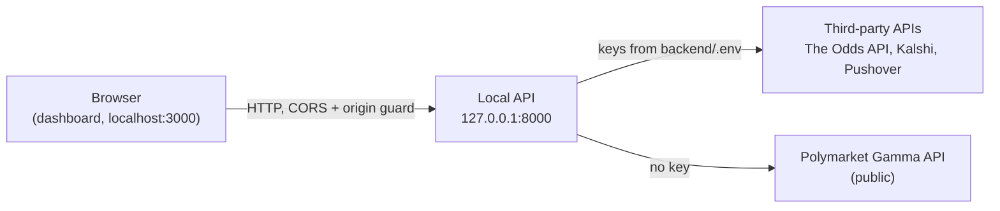

# Security Policy

## Supported deployment model

Prediction Market Scanner is a **local, single-user** application. It runs on one machine for one operator. It has no other supported deployment model.

- **No authentication.** The FastAPI backend (`backend/main.py`) has no login, sessions, API tokens, or per-user authorization. Anyone who can reach the backend port can read its data and call every endpoint.
- **Loopback binding.** The backend runs under uvicorn without a `--host` flag (`start-dev.bat`: `uvicorn main:app --reload --port 8000`), so it listens on uvicorn's default, `127.0.0.1`.
- **CORS.** `backend/main.py` (`ALLOWED_ORIGINS`) allows only `http://localhost:3000` and `http://127.0.0.1:3000`, which is where the Next.js dashboard runs, and only the `GET`, `POST` and `OPTIONS` methods.
- **Cross-site request guard.** CORS stops other origins from reading responses, but it does not stop them from sending them. `OriginGuardMiddleware` (`backend/services/origin_guard.py`) rejects any non-`GET`/`HEAD`/`OPTIONS` request whose `Origin` header is not in `ALLOWED_ORIGINS`, including `Origin: null`. Requests with no `Origin` header, such as curl or scripts, are allowed. This is a defense against CSRF from web pages; it does not authenticate local processes.

**Never expose the backend to a network.** Any process on the host, and any host that can reach the port, has full control of the API.

## Trust boundaries

1. **Browser to local API.** The only control is the origin check described above. Requests that do not come from a browser are trusted.
2. **Local API to third-party APIs.** The backend reads credentials through `load_dotenv()` in `backend/main.py`, which loads `.env` from the working directory; `start-dev.bat` starts uvicorn from `backend/`, so this is `backend/.env`. The Odds API, Kalshi and Pushover use keys. The Polymarket Gamma API is a public endpoint and needs none (`backend/.env.example`). Responses from third parties are normalized by the platform adapters and treated as untrusted market data.

### Endpoints that change state or have external effects

All of these are `POST` requests under `/api`:

| Endpoint | Effect | Source |
|---|---|---|
| `/monitor/start`, `/monitor/stop` | Starts or stops the background monitor (polling, WebSockets, alert evaluation) | `backend/routers/monitor.py` |
| `/monitor/config` | Changes alert thresholds, platforms and `dry_run`. Can also set Pushover credentials in memory. | `backend/routers/monitor.py` (`update_monitor_config`) |
| `/monitor/test` | Sends a **real** Pushover notification and **bypasses `dry_run`** | `backend/routers/monitor.py` (`test_notification`) |
| `/scan/config` | Changes enabled sports and platforms, odds TTLs and the Odds API daily budget | `backend/routers/scan.py` (`post_config`) |
| `/opportunities/refresh` | Starts a background pipeline refresh, which uses Odds API quota | `backend/routers/opportunities.py` (`refresh_opportunities`) |
| `/maker/config` | Updates paper-maker settings. Only an allowlisted set of fields can be changed, and the paper-mode invariants are re-applied after each update. | `backend/routers/maker.py` (`update_maker_config_endpoint`) |

Some `GET` endpoints also call third-party APIs and can use Odds API quota. Examples are `/api/odds/tennis` and the cold-start path of `/api/opportunities`.

`MonitorConfig.dry_run` defaults to `True` (`backend/services/monitor/config.py`), so live alert delivery must be turned on explicitly. `GET /api/monitor/config` returns only a `has_pushover_credentials` flag and never the credential values.

## Secrets handling

- `.env` is listed in `.gitignore`. `backend/.env.example` contains placeholder variable names only (`ODDS_API_KEY`, `KALSHI_API_KEY`, `PUSHOVER_USER_KEY`, `PUSHOVER_API_TOKEN`, `GAMMA_API_BASE`).
- The Odds API key is sent as a query parameter. To keep it out of logs and error text, `backend/services/redaction.py` provides:
  - `redact_secrets`, which masks the values of `apiKey`, `api_key`, `token`, `access_token` and `user` parameters.
  - `SecretRedactionFilter` and `configure_log_redaction`, which attach that masking to the `httpx`/`httpcore` loggers and to the root log handlers. `backend/main.py` calls `configure_log_redaction()` at startup.
  - Error text that reaches snapshot status (`services/snapshot.py`) or HTTP error details (`routers/opportunities.py`) passes through `redact_secrets`. Error log lines in `services/odds_provider.py`, `services/events.py`, `services/monitor/odds_poller.py` and `routers/odds.py` are redacted the same way.
  - `routers/odds.py` returns fixed messages for upstream fetch failures, and per-sport fetch failures in `services/odds_provider.py` record only the HTTP status or the exception type name, so request URLs do not reach them.
- Redaction only works on known parameter names. Do not log raw request headers, credential objects or the contents of `.env`.

## No trade execution

The tool supports decisions only. It contains no order placement, wallet or transaction signing, and no authenticated order submission. The maker subsystem is **paper only**: `MakerConfig.enabled` defaults to `False`, `paper_only` defaults to `True`, and the scope defaults to Kalshi H2H markets (`backend/services/maker/config.py`). `paper_only` and the scope cannot be changed through the API: `POST /api/maker/config` leaves them out of the updatable fields and re-applies `paper_only=True` and the Kalshi/H2H scope on every update (`_enforce_safety` in `backend/routers/maker.py`). Any action on a marketplace is taken manually by the user, outside this tool.

## Credential-free evaluation

An offline demo mode runs synthetic data through the real pipeline without any API keys. See `docs/DEMO_GUIDE.md`.

## What not to do

- Do not bind the backend to `0.0.0.0` or another non-loopback address (for example `uvicorn main:app --host 0.0.0.0`).
- Do not port-forward, tunnel, reverse-proxy, or otherwise publish port 8000 or the dashboard.
- Note that `next dev` (`frontend/package.json`) listens on all interfaces by default, so the dashboard dev server is reachable from the local network. Its browser requests go to the viewer's own `localhost:8000` (`frontend/lib/api.ts`, overridable with `NEXT_PUBLIC_BACKEND_URL`), but to keep it on loopback run `npx next dev -H 127.0.0.1`.
- Do not add origins to `ALLOWED_ORIGINS` unless you control them.
- Do not commit `.env` or `backend/.env`, and do not paste keys into issues, logs or screenshots.
- Do not call `POST /api/monitor/test` unless you intend to send a real notification.

## Reporting a vulnerability

Please report suspected vulnerabilities privately using a [GitHub private security advisory](https://docs.github.com/en/code-security/security-advisories/guidance-on-reporting-and-writing-information-about-vulnerabilities/privately-reporting-a-security-vulnerability) ("Report a vulnerability" under the repository's **Security** tab). Do not open a public issue. Include the affected file or endpoint, the steps to reproduce, and the impact. Do not include real credentials.
