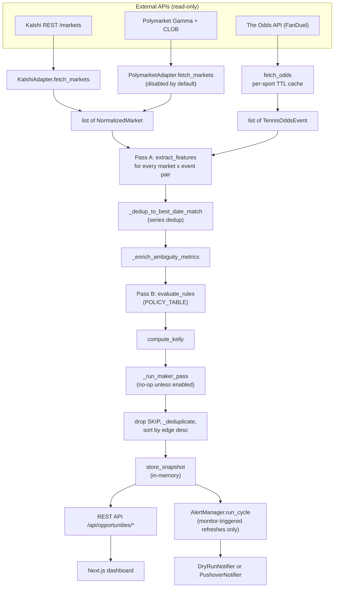
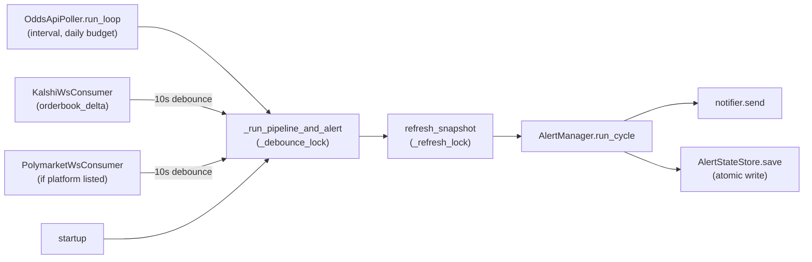

# Architecture

This document describes how the MasG EV Tool is built, as it stands in the source code. When this document and the code disagree, the code is correct. All paths are relative to the repository root.

Contents:

1. [System overview and trust boundary](#1-system-overview-and-trust-boundary)
2. [Component map](#2-component-map)
3. [End-to-end data flow](#3-end-to-end-data-flow)
4. [The NormalizedMarket contract](#4-the-normalizedmarket-contract)
5. [Matching and false-positive defenses](#5-matching-and-false-positive-defenses)
6. [Pricing model](#6-pricing-model)
7. [Policy engine (Pass B)](#7-policy-engine-pass-b)
8. [Snapshot and background refresh](#8-snapshot-and-background-refresh)
9. [Caching layers and Odds API quota](#9-caching-layers-and-odds-api-quota)
10. [Monitoring and alerts](#10-monitoring-and-alerts)
11. [Paper maker subsystem](#11-paper-maker-subsystem)
12. [Failure handling matrix](#12-failure-handling-matrix)
13. [Concurrency model](#13-concurrency-model)
14. [Configuration](#14-configuration)
15. [Testing strategy](#15-testing-strategy)
16. [Key design tradeoffs](#16-key-design-tradeoffs)
17. [Known limitations](#17-known-limitations)

---

## 1. System overview and trust boundary

The MasG EV Tool is a local, single-user scanner that supports decisions. It reads prices from prediction markets (Kalshi, and optionally Polymarket) and compares each one with a **model probability**: the FanDuel-implied, devigged probability fetched through The Odds API. When a market's entry price is below the model probability by enough margin, and every matching and data-quality check passes, the market is labelled `BUY`. Otherwise it is labelled `WATCH` or `SKIP`.

The model probability is an estimate taken from one sportsbook's prices. It is not an objectively true probability. In the code it is called `p_true`.

The trust boundary:

| Concern | Position |
|---|---|
| Users | One operator, on their own machine. There are no accounts and no authentication. |
| Network exposure | The backend is started with uvicorn without `--host` (`start-dev.bat`), so it listens on uvicorn's default, `127.0.0.1`. The application itself does not enforce this. CORS allows only `http://localhost:3000` and `http://127.0.0.1:3000` (`ALLOWED_ORIGINS` in `backend/main.py`), with methods GET, POST and OPTIONS. In addition, `OriginGuardMiddleware` (`backend/services/origin_guard.py`) returns `403` for any non-GET/HEAD/OPTIONS request carrying a foreign or `null` `Origin`. Requests without an `Origin` header (curl, server-side rendering, tests) are allowed. |
| Market actions | **None.** No code places orders, signs transactions, or holds wallet keys. Every market action is taken by hand, outside the tool. |
| Outbound writes | Pushover notifications only, and only when the monitor is switched out of dry-run. `POST /api/monitor/test` is a deliberate exception: it sends a real test push. |
| Credentials | Read from environment variables (`ODDS_API_KEY`, `KALSHI_API_KEY`, Pushover keys). Credential query parameters are masked in logs and error strings (`backend/services/redaction.py`). |
| Local persistence | Alert cooldown state (`backend/data/alert_state.json`) and paper-maker JSONL records (`backend/data/maker_paper_orders/`). Both paths are git-ignored. |

An offline demo mode sends synthetic data through the same pipeline. See `docs/DEMO_GUIDE.md`.

## 2. Component map

```
backend/
  main.py                      FastAPI app, CORS, origin guard, log redaction, router mounting
  routers/
    opportunities.py           snapshot reads, /status, /refresh, /policy, /history, /debug
    scan.py                    ScanConfig read/write, /data-status, /sports
    monitor.py                 MonitorConfig, start/stop, status, history, test push
    maker.py                   paper-maker proposals, summary, config
    odds.py                    legacy tennis odds and matcher endpoints
  services/
    adapters/base.py           NormalizedMarket dataclass, MarketAdapter protocol
    adapters/kalshi.py         Kalshi REST ingestion -> NormalizedMarket
    adapters/polymarket.py     Polymarket Gamma discovery + CLOB pricing -> NormalizedMarket
    events.py                  Polymarket Gamma paging (per-tag isolation)
    clob_polymarket.py         bounded-concurrency CLOB order-book fetch
    odds_provider.py           The Odds API client (fetch_odds, fetch_props, historical odds)
    odds_cache.py / prop_cache.py / discovery_cache.py   in-memory TTL caches
    normalizer.py              name normalization (NFKD, accent strip, tokenization)
    matcher.py                 Polymarket market-type classification, legacy matcher
    feature_extractor.py       Pass A for h2h / totals / handicap
    prop_extractor.py          Pass A for player props (off by default)
    devig.py                   multiplicative 2-way and 3-way devig
    rule_engine.py             MarketFeatures, POLICY_TABLE, evaluate_rules, compute_kelly
    opportunities.py           pipeline orchestration: fetch_opportunities()
    snapshot.py                in-memory snapshot, refresh lock, background refresh
    price_history.py           Polymarket (CLOB prices-history) and Kalshi (candlestick) price history for the market detail panel
    origin_guard.py            rejects cross-origin state-changing requests
    redaction.py               API-key masking for logs and error strings
    engine_config.py / sports_config.py / scan_config.py   configuration
    monitor/                   scheduler, odds poller, WS consumers, AlertManager, notifier, state
    maker/                     paper-maker config, planner, policy, service, JSONL store (state.py), tick helpers, read-only orderbook model
  tests/                       pytest suite (offline)
frontend/
  app/page.tsx                 server-side initial snapshot fetch
  app/components/dashboard/    DashboardClient, OpportunitiesTable, MarketDetailPanel, ...
  app/model/page.tsx           model explainer page
  lib/api.ts, lib/monitor-api.ts   all backend HTTP calls (with request timeouts)
  lib/useTrackedPositions.ts   localStorage tracked positions and CLV backfill
```

Every frontend HTTP call goes through `frontend/lib/api.ts` or `frontend/lib/monitor-api.ts`. Both read `NEXT_PUBLIC_BACKEND_URL`, which defaults to `http://localhost:8000`.

## 3. End-to-end data flow

`fetch_opportunities()` in `backend/services/opportunities.py` is the production orchestrator. It is called only from `refresh_snapshot()` (`backend/services/snapshot.py`). `GET /api/opportunities/debug` runs a separate diagnostic pipeline, `diagnose_pipeline()` (same module). It does not apply the `ScanConfig` platform toggles, does not run series dedup (`_dedup_to_best_date_match`), and runs outside `_refresh_lock`, so its results can differ from the production path.



The steps, in order (`fetch_opportunities`):

1. **Fetch in parallel.** The enabled adapters (filtered by `ScanConfig.platforms`), `fetch_odds(bookmaker="fanduel")` and, if `EngineConfig.enable_props` is set, `fetch_props` all run under one `asyncio.gather`.
2. **Pass A.** `extract_features(market, event, cfg)` runs over the full cross product of markets and events. It returns zero, one or two `MarketFeatures` per pair: two for h2h, one per side. Props are extracted separately, with a per-event cap (`max_props_per_event`).
3. **Series dedup.** `_dedup_to_best_date_match` keeps, for each `(platform, market_id)`, only the features of the event with the highest `date_score`.
4. **Ambiguity enrichment.** `_enrich_ambiguity_metrics` sets `competing_matches`, `confidence_gap` and `has_shared_last_name`.
5. **Pass B.** `evaluate_rules` classifies each feature, and `compute_kelly` sizes it.
6. **Paper maker pass.** `_run_maker_pass` returns straight away when `MakerConfig.enabled` is `False`.
7. **Output.** SKIP results are left out of the returned list. They are still counted in `meta["status_counts"]`. The remaining results are deduplicated by `(platform, event, market_type, side, line)`, keeping the highest edge, and sorted by edge in descending order.
8. **Meta.** The run returns quota fields, `sports_failed`, `platforms_fetched`, `kalshi_series_counts` and `markets_dropped_by_type` alongside the opportunities.

## 4. The NormalizedMarket contract

`NormalizedMarket` (`backend/services/adapters/base.py`) is a frozen dataclass. Each adapter has to emit this exact shape. Code below the adapters never reads raw platform payloads. Within Pass A, the only platform-specific branches are `_cost_buffer` and `_sport_compatible` in `feature_extractor.py`. Platform is also used later as a scope or routing key: the AlertManager platform allowlist, the WebSocket watch lists (`MonitorScheduler._update_watch_lists`), the maker scope filter (`_run_maker_pass`) and `price_history.fetch_price_history`.

| Group | Fields | Notes |
|---|---|---|
| Identity | `platform`, `market_id` | `market_id` is the Kalshi ticker or the Polymarket market id. |
| Event | `event`, `market_type`, `side`, `line` | `side` is a hint for which team or player YES refers to. `line` is `None` for h2h, and also for Polymarket totals, whose line Pass A parses from the question. |
| Pricing | `price`, `outcome_prices`, `liquidity`, `bid_ask_spread` | `outcome_prices` holds `[yes, no]` as strings, as probabilities in 0..1. Pass A reads prices from this field. |
| Matching | `question`, `end_date`, `event_slug`, `url`, `timestamp` | `end_date` is used for date proximity. Both adapters use a date-at-`T23:59Z` convention. |
| Top of book | `best_bid`, `best_ask`, `best_bid_market_id`, `best_bid_contract_side`, `no_player_*` | Used only by the paper maker. Only 2-way Kalshi markets fill in the `no_player_*` fields. |
| Staleness | `fetched_at` | Kalshi: the newest `last_updated_ts` reported by the API across the event's markets, falling back to the fetch time per market (`_build_event_markets`). Polymarket: `time.time()` after the CLOB books are fetched. |

Adapter specifics:

- **Kalshi** (`adapters/kalshi.py`, `_build_event_markets`). Markets are grouped by event ticker.
  - A 2-way event becomes one `NormalizedMarket` priced at the cheaper of the two routes to each side. Buying YES on one team is equivalent to buying NO on the other.
  - A 3-way (soccer) event becomes one `NormalizedMarket` per team, each priced from that team's own YES ask. The draw/Tie leg is never emitted as an h2h market (`_is_draw_market`). A 3-way group that cannot form two valid team markets emits nothing.
- **Polymarket** (`adapters/polymarket.py`). Discovery uses Gamma tags. Prices come only from live CLOB best asks; the stale Gamma `outcomePrices` are never used as the price. Crossed books and spreads wider than `_MAX_BID_ASK_SPREAD` are rejected. Only `h2h` and `totals` survive classification (`matcher.classify_pm_market_type`).

Neither adapter currently emits `handicap` or `first_set`, although both are listed in the field comment.

## 5. Matching and false-positive defenses

False positives are treated as worse than missed opportunities. The defenses are layered: Pass A computes signals and records them, and Pass B decides. Everything below is in `backend/services/feature_extractor.py` unless another file is named.

**Name matching** (`_name_score`):

1. A full normalized-name substring match on both teams or players scores `1.0`.
2. If that fails, the fallback is a last-name word match. It is skipped when both names share the same last token (for example `city` and `city`). It is also rejected when a matched last token is in `_AMBIGUOUS_SUFFIXES` (`united`, `giants`, `sox`, ...) and the full name does not appear in the question.
3. Before scoring, a market's side hint (in practice Kalshi abbreviations) can be expanded to full FanDuel names. For Kalshi this happens only when the series sport matches the event sport (`_sport_compatible`), to avoid cross-sport city collisions; `_sport_compatible` returns `True` for other platforms.
4. A pair with `name_score == 0` produces no features. This is the only hard filter in Pass A. `_parse_prices` also returns nothing when the YES price is unparseable or outside `[0.01, 0.99]`.

**Date proximity** (`_date_score`):

- The score is bucketed on |market end − event start|: ≤6h → 1.0, ≤24h → 0.95, ≤168h → 0.85, ≤504h → 0.70, otherwise 0. A missing date scores 0.5.
- Confidence is `0.65 × name + 0.35 × date`. A missing date therefore gives 0.825, which is below the 0.85 survival threshold.
- Separately, the CRITICAL `date_not_stale` rule enforces `SportConfig.max_date_delta_hours`. Liquid team sports override it to 12h to block wrong-game matches within a series.

**Outcome alignment.** The adapter's `side` hint is matched against the FanDuel home and away names. If the hint matches neither, `_identify_yes_player` falls back to the position of each name in the question. When the two positions are equal (same last name, or one name a prefix of the other), `outcome_aligned=False`, and the CRITICAL rule `OUTCOME_NOT_ALIGNED` fails.

**Line, unit and side** (totals/handicap only):

- `line_match_exact` requires the sportsbook line to match within 0.01.
- `unit_match` rejects set-based totals, because sportsbook totals are counted in games.
- `side_match` checks the favored side on handicap markets.
- All three are CRITICAL rules.

**Last-name collision.** `_detect_last_name_collision` flags a player whose last name is a token of the opponent's full name. That raises the DOWNGRADE rule `LAST_NAME_COLLISION`.

**Soccer draw guard.** For `soccer_*` sport keys (`_is_three_way_sport`), a FanDuel line without draw odds is treated as having no bookmaker data, which gives a `NO_BOOKMAKER_DATA` SKIP. Without this guard, the 2-way devig would spread the missing draw probability across both teams and show phantom edge on both sides.

**Unbuyable complement.** If the NO price is 0.99 or higher, it is passed through unchanged rather than re-priced as `1 − yes`; `_parse_prices` synthesizes `1 − yes` only when NO < 0.01, and any other NO value is passed through unchanged. The CRITICAL `price_range` rule (`0.02 < price < 0.98`) rejects that side with `PRICE_OUT_OF_RANGE`. `prices_consistent` fails as well only if YES + NO exceeds 1.15.

**Plausibility and coherence** (`backend/services/rule_engine.py`):

- `edge_plausible` (DOWNGRADE) caps the edge at the per-sport `SportConfig.max_plausible_edge`, looked up with `config_for_odds_key` (`backend/services/sports_config.py`). The value is 0.20 by default, and `EngineConfig.max_plausible_edge = 0.20` is the fallback when no sport matches. Liquid leagues are tighter: NBA, NHL and NFL use 0.12; MLB, WNBA, AHL and the soccer leagues use 0.15. Tennis and MMA are looser at 0.25.
- `price_prob_coherence` (CRITICAL) fails when |price − p_true| > 0.40. That gap usually means the side is inverted.
- `prices_consistent` (DOWNGRADE) requires `0.85 ≤ yes + no ≤ 1.15`.

**Series dedup and ambiguity.** In a multi-game series, several FanDuel events can match one market. Series dedup keeps only the event with the best date score. The ambiguity metrics (`competing_matches`, `confidence_gap`, `shared_last_name`) are computed after dedup. See [Known limitations](#17-known-limitations) for what this ordering means.

## 6. Pricing model

| Step | Formula | Location |
|---|---|---|
| American odds → implied | `odds ≥ 0: 100/(odds+100)`; `odds < 0: |odds|/(|odds|+100)` | `feature_extractor._american_to_implied` (copies in `prop_extractor.py` and `odds_provider.py`) |
| 2-way devig | `p_i = imp_i / (imp_home + imp_away)`, rounded to 4 dp | `devig.devig_multiplicative` |
| 3-way devig | `p_i = imp_i / (imp_home + imp_away + imp_draw)` | `devig.devig_3way` (used whenever FanDuel publishes draw odds) |
| Overround | `Σ implied − 1` | `extract_h2h_features` |
| Effective price | `pm_price_effective = price + cost_buffer` | `_cost_buffer`: `0.0` for Polymarket, `EngineConfig.cost_buffer = 0.01` otherwise |
| Edge | `edge = round(p_true − pm_price_effective, 4)` | `extract_h2h_features`, `extract_totals_features`, `extract_handicap_features`, `prop_extractor` |
| Full Kelly | `f = (p_true − pe) / (1 − pe)`, clamped to `[0, kelly_cap]` with `kelly_cap = 0.25` | `rule_engine.compute_kelly` |
| Recommended stake | `MarketFeatures.kelly_fraction = kelly_full × EngineConfig.kelly_fraction` (0.20, one-fifth Kelly); with `kelly_cap = 0.25` it is at most 0.05 of bankroll | `rule_engine.compute_kelly` → `_features_to_opportunity` → `EvaluatedOpportunity.recommended_kelly` |

Kelly is set to 0 when `edge ≤ 0` or `pe ≥ 1`. It is computed for every candidate, but it only means something for BUY.

FanDuel quality labels feed the policy:

- Line width is `|p_home − p_away|`: ≤0.10 is Tight, ≤0.35 is Moderate, above that is Wide.
- The overround tier is ≤3% High, ≤6% Medium, otherwise Low. A Wide line lowers the tier by one step.

## 7. Policy engine (Pass B)

`POLICY_TABLE` in `backend/services/rule_engine.py` is the only place classification logic lives. It holds **23 rules**: **13 CRITICAL** and **10 DOWNGRADE**. `GET /api/opportunities/policy` serves the table as is.

| Stage | Rule (reason code) | Severity |
|---|---|---|
| fetch | `price_range` (PRICE_OUT_OF_RANGE, 0.02 < p < 0.98), `not_live` (EVENT_LIVE), `has_bookmaker` (NO_BOOKMAKER_DATA) | CRITICAL |
| match | `name_match`, `outcome_alignment`, `confidence_survival` (≥ 0.85) | CRITICAL |
| alignment | `line_match`, `unit_match`, `side_match` | CRITICAL |
| date | `date_not_stale` (per-sport `max_date_delta_hours`) | CRITICAL |
| pricing | `price_prob_coherence`, `positive_edge`, `min_true_prob` (≥ 0.40) | CRITICAL |
| quality | `confidence_buy` (≥ 0.90), `edge_threshold`, `fd_confidence`, `edge_plausible` | DOWNGRADE |
| ambiguity | `confidence_gap`, `shared_last_name`, `competing_matches`, `last_name_collision` | DOWNGRADE |
| metadata | `metadata_complete`, `prices_consistent` | DOWNGRADE |

How a candidate is classified (`evaluate_rules`):

- **SKIP** if any CRITICAL rule fails.
- **WATCH** if no CRITICAL rule fails but at least one DOWNGRADE rule fails.
- **BUY** only if every rule passes.

Every rule is evaluated, even after a failure. The full trace is stored in `rule_evaluations` alongside `reject_reasons` and `downgrade_reasons`, so the dashboard's market detail panel can show why a market got its label.

`edge_threshold` uses `wide_market_min_edge` (0.08) when the FanDuel line width is above 0.35. Otherwise it uses the sport's `SportConfig.min_edge`, and only falls back to `EngineConfig.min_edge` when no sport config matches.

## 8. Snapshot and background refresh

`backend/services/snapshot.py` keeps the latest result in a module global, `_snapshot`. A snapshot holds the opportunities, meta, `updated_at` and trigger. Readers never run the pipeline, with one exception: a cold start.

- **`refresh_snapshot(trigger, scope, cfg, only_if_missing)`** is the single runner shared by every writer.
  - It takes `_refresh_lock` and invalidates odds-cache entries according to `scope`: `"stale"` (TTL only), `"all"`, or a single sport key.
  - It then runs `fetch_opportunities` and stores the result.
  - On an exception it records a redacted, truncated `_last_refresh_error`, keeps the previous snapshot, and re-raises.
  - It always records the run duration and clears the in-flight flags.
- **Single-flight manual refresh.** `start_background_refresh` decides whether to start under `_start_lock`. If a refresh is already running or `_refresh_lock` is held, it returns `already_running`. Otherwise it sets the in-flight flags synchronously and starts a detached task. It keeps a strong reference to the task in `_background_task`. `POST /api/opportunities/refresh` always returns `202` with the current status.
- **Cold start.** `GET /api/opportunities` with no snapshot awaits `refresh_snapshot(trigger="cold_start", only_if_missing=True)` inline. Concurrent cold-start requests queue on the lock and reuse the first result. A missing `ODDS_API_KEY` returns `503`; any other pipeline exception returns `502`. The dashboard also starts one scan automatically when it sees no snapshot.
- **Status metadata.** `GET /api/opportunities/status` (`_build_status_response`) reports:
  - `is_refreshing`, `refresh_started_at`, `last_refresh_error`, `last_refresh_duration_seconds` and `last_trigger`
  - status counts and `platforms_fetched`
  - `odds_failures` (from `meta["sports_failed"]`), and `degraded = bool(sports_failed)`

  `degraded` marks a refresh that succeeded only in part. That case is not shown as fully fresh.
- **Frontend polling.** The dashboard polls `/status` every 2s while a refresh is running or no snapshot exists, and every 10s otherwise. It fetches `/snapshot` only when `updated_at` changes. Request timeouts, backend outages and stale data are shown in the UI.

There are no FastAPI lifespan hooks (`backend/main.py`). Nothing starts automatically except the cold-start path above.

## 9. Caching layers and Odds API quota

| Cache | Location | Key | TTL | Behaviour on miss or failure |
|---|---|---|---|---|
| FanDuel odds | `services/odds_cache.py` | Odds API sport key | `SportScanConfig.odds_ttl_seconds` (default 900s) | The sport is refetched once the TTL expires. If the refetch fails, an expired entry is evicted and a still-fresh one is kept (`_record_sport_fetch_failure`). |
| Sport-key resolution | `odds_provider._discovery_cache` | single entry | 3600s (`_DISCOVERY_TTL`) | If the lookup fails, the stale cache is reused. |
| Market discovery | `services/discovery_cache.py` | sport key | 14400s (4h) | Only used for logging and validation. Applies only to sports with `enable_discovery`. |
| Props | `services/prop_cache.py` | sport key | `fetch_props(ttl_seconds=900)` | Only used when `enable_props` is on. |

All four caches are plain module-level dicts held in process memory. A restart empties them.

**What protects the Odds API quota:**

- The per-sport TTL cache. With the default `scope="stale"`, repeated refreshes inside the TTL make no Odds API calls.
- Disabled sports are skipped before any request is made.
- The 1h sport-key cache.
- `OddsApiPoller`'s daily poll budget (`MonitorConfig.odds_api_max_polls_per_day`, default 20). It counts polls, not credits.
- Single-flight manual refresh, plus `_refresh_lock`, which prevents pipeline runs from overlapping.

**What does not protect the quota:**

- `ScanConfig.global_max_odds_api_per_day` is stored but never enforced.
- `scope="all"` and per-sport scopes bypass the TTL on purpose.
- Monitor refreshes triggered by WebSockets and manual refreshes are not counted against the poller budget.
- Discovery sports also call `_sample_alternate_lines`, which spends credits and only logs.
- `GET /api/opportunities/debug` goes through `fetch_odds` (it uses the odds TTL cache) but runs outside `_refresh_lock`. `GET /api/opportunities/historical-odds` (`fetch_historical_odds`) and the legacy `/api/odds/*` routes (`fetch_tennis_odds`) bypass both the odds cache and the lock.
- There is no retry and no special handling of HTTP 429. A failed sport is recorded in `sports_failed` and is not retried until the next refresh.

## 10. Monitoring and alerts

All monitoring lives in `backend/services/monitor/`. One `MonitorConfig` and one `MonitorScheduler` exist, both module-level in `backend/routers/monitor.py`.



- **Scheduler** (`scheduler.py`). `POST /api/monitor/start` and `/stop` are serialized by `_lifecycle_lock`.
  - `start()` runs one `startup` cycle first. It then starts the odds poller and a WebSocket consumer for each platform in `MonitorConfig.platforms`; by default that is `["kalshi"]` only. If `stop()` is called during the startup cycle, no source tasks are started.
  - `stop()` cancels the tasks, awaits them and saves alert state.
  - Monitor cycles pass an `EngineConfig` with `min_edge = min_ev × 0.5` and write to the same shared snapshot the dashboard reads.
  - If `refresh_snapshot` raises, no alerts are sent for that cycle, so the monitor never alerts from a previous snapshot.
- **Odds poller** (`odds_poller.py`). Calls `fetch_odds` on a fixed interval (default 15 min) and invokes the callback when it gets events back. Poll errors are logged with credentials redacted.
- **WebSocket consumers** (`ws_kalshi.py`, `ws_polymarket.py`).
  - Watch lists come from non-SKIP opportunities after each cycle. Subscriptions are sent when a connection opens.
  - Reconnects back off exponentially: 5, 10, 20, 40, then a 60s cap (`_backoff_delay`). Clean server closes back off too. The counter resets only after the first message arrives.
  - Kalshi stops reconnecting on 401/403.
  - A price change of at least 0.01 triggers a cycle. The scheduler's 10s debounce drops triggers that arrive within the window; it does not delay them.
- **AlertManager decision tree** (`manager.py`, `run_cycle`). For each opportunity:
  1. **Filter** (`_passes_filters`). The opportunity must have `status == "BUY"`, `edge ≥ min_ev`, a platform in `MonitorConfig.platforms` and a market type in `market_types`. When `exclude_ambiguity_downgraded` is set, it must also carry none of the ambiguity downgrade reasons; since a BUY has no failed downgrade rules by definition, this check does not fire in practice and acts only as a backstop. WATCH and SKIP never alert.
  2. **Decide** (`_decide`):
     - **NEW** if it has never been alerted, or the cooldown has expired.
     - **IMPROVED** if it is within the cooldown and the edge has risen by at least `resend_edge_improvement` (0.03) since the last alert.
     - **COOLDOWN** otherwise (suppressed).
  3. **Hourly cap.** `send_cap = max(0, min(max_alerts_per_hour − sent_this_hour, len(to_alert)))`. When the cap applies, the highest edges are kept.
  4. **Send.** Only a successful send marks the record as alerted. Failures are counted in `alerts_failed`.
  5. **Persist** state (`state.py`) by writing a temp file and replacing the target with `os.replace`.
- **Notifier** (`notifier.py`).
  - `MonitorConfig.dry_run` defaults to `True`. Config lives only in memory, so a restart always comes back in dry-run.
  - In dry-run, `DryRunNotifier` logs `[DRY RUN] Would send: ...`. Otherwise `PushoverNotifier` posts to Pushover.
  - `update_config` rebuilds the notifier on every call: `DryRunNotifier` when `dry_run` is `True`, otherwise `PushoverNotifier` with the current credentials. The router calls it on `POST /api/monitor/config`, `/start` and `/stop`.
  - `POST /api/monitor/test` is the only path that bypasses dry-run.

## 11. Paper maker subsystem

`backend/services/maker/` produces **simulated proposals only**. It contains no order placement, no signing and no authenticated order submission.

- **Gating.**
  - `MakerConfig.enabled=False` by default. When disabled, `_run_maker_pass` (`services/opportunities.py`) returns before importing the maker modules and writes nothing.
  - `POST /api/maker/config` (`routers/maker.py`, `_enforce_safety`) always forces `paper_only=True`, `platforms=("kalshi",)` and `market_types=("h2h",)`. It rejects non-finite or negative numbers.
  - The runtime override lives only in memory.
- **Eligibility** (`policy.py`). Proposals inherit every taker rule in `POLICY_TABLE` except `positive_edge` and `edge_threshold`, and they treat inherited DOWNGRADE rules as blocking. On top of that come 11 maker-only CRITICAL rules covering scope, book and FanDuel staleness, book shape, bid bounds and maker edge.
- **Math** (`planner.py`). `maker_max_bid = round_down_to_tick(p_true − required_edge − cost_buffer)`. The proposed bid is `min(best_bid + 1 tick, maker_max_bid)`.
- **Persistence** (`state.py`, `PaperMakerStore`). Appends one JSON line per proposal to `backend/data/maker_paper_orders/YYYY-MM-DD.jsonl`. Readers skip corrupt lines. Writes are serialized because the maker pass runs under `_refresh_lock`.
- **Endpoints.** `GET /api/maker/proposals`, `/summary`, `/config` and `POST /api/maker/config`.

## 12. Failure handling matrix

| Failure | Behaviour | How it is surfaced |
|---|---|---|
| `ODDS_API_KEY` missing | `fetch_odds` raises `ValueError`; the refresh fails and the previous snapshot is kept | `last_refresh_error` in `/status`; a cold start returns `503` |
| Odds API error for one sport (HTTP status, timeout, 429) | Logged with credentials redacted. A still-fresh cache entry is kept; an expired one is evicted, so that sport's markets get no FanDuel match | `/status`: `degraded=true`, `odds_failures[]` with `sport_key`, `error`, `stale_age_seconds` |
| Sport-key lookup fails | The stale sport-key cache is reused. With no cache, group-based sports (tennis) are absent from that run | Backend log |
| `KALSHI_API_KEY` missing | The Kalshi adapter returns `[]` | Debug log; zero Kalshi markets |
| Kalshi series request fails | That series is skipped and the others continue | `meta.kalshi_series_counts` shows `-1` for the series |
| Polymarket tag fetch fails | That tag is skipped (`return_exceptions=True`); `CancelledError` still propagates | Warning log |
| Polymarket CLOB book missing, crossed or too wide | The market is dropped; no fallback price is used | Only in aggregate, through the adapter's INFO summary line (candidates vs normalized counts); no per-market log entry is written |
| Unhandled exception in the pipeline | `refresh_snapshot` records the redacted error and re-raises; the previous snapshot is kept | `last_refresh_error`; the dashboard shows an error banner |
| Monitor pipeline fails | No alerts that cycle | Backend log |
| Notifier send fails | Not marked alerted, so it can be retried next cycle | `alerts_failed` in the cycle result |
| WebSocket disconnect | Exponential backoff up to 60s; Kalshi stops on 401/403 | `/api/monitor/status` WS fields |
| Alert state file unreadable | Starts with empty state | Warning log |
| Price history fetch fails | Returns `[]` (looks the same as "no history") | None |
| Backend unreachable from the UI | The request times out after 15s (longer for monitor start) | Outage and staleness indicators in the dashboard |

## 13. Concurrency model

The backend runs in one process on a single asyncio event loop (uvicorn). All state is module-level and held in memory. There are no threads or worker processes. Code between two `await` points cannot interleave with other code.

| Lock or primitive | File | Guards |
|---|---|---|
| `_refresh_lock` (`asyncio.Lock`) | `services/snapshot.py` | Every `refresh_snapshot` run: pipeline execution, odds-cache invalidation, snapshot writes, paper-maker JSONL appends |
| `_start_lock` | `services/snapshot.py` | The decision to start a background refresh, so a double `POST /refresh` starts only one |
| `_debounce_lock` | `services/monitor/scheduler.py` | One monitor pipeline-and-alert cycle at a time; AlertManager state changes |
| `_lifecycle_lock` | `services/monitor/scheduler.py` | `start()` and `stop()`, so no duplicate or orphaned poller or WS tasks |
| `asyncio.Semaphore(50)` | `services/clob_polymarket.py` | Fan-out of Polymarket order-book requests |

Calls to `refresh_snapshot` queue on the lock. Each queued caller then runs its own pipeline; only the cold-start path reuses a result that arrived while it waited.

`OddsApiPoller.poll_once` and `diagnose_pipeline` call the provider outside `_refresh_lock`. They can therefore overlap with a pipeline run on the shared odds cache.

## 14. Configuration

| Config | Where | Scope | Mutable at runtime |
|---|---|---|---|
| `EngineConfig` | `services/engine_config.py` | Edge thresholds, probability floor, confidence thresholds, overround tiers, Kelly cap and fraction, cost buffer, price range, ambiguity limits, divergence, plausibility, props flag | No; built per call (`DEFAULT_CONFIG`, or the monitor's or debug endpoint's own instance) |
| `SportConfig` / `SPORTS` | `services/sports_config.py` | Per-sport Odds API keys or group, Kalshi series, Polymarket tag, market types, `min_edge`, `max_plausible_edge`, `max_date_delta_hours`; looked up with `config_for_odds_key` | No (frozen) |
| `ScanConfig` | `services/scan_config.py` | Per-sport enable flag and odds TTL; platform toggles (Kalshi on, Polymarket off) | Yes, via `POST /api/scan/config` (in memory) |
| `MonitorConfig` | `services/monitor/config.py` | `min_ev`, platform and market-type allowlists, ambiguity exclusion, cooldown, resend threshold, hourly cap, poll interval and budget, `dry_run=True`, presets | Partly: `POST /api/monitor/config` updates preset, `min_ev`, platforms, market types, cooldown, hourly cap, refresh interval, `dry_run` and credentials (in memory). The ambiguity exclusion, resend threshold, daily poll budget and high-priority threshold stay at their code defaults. |
| `MakerConfig` | `services/maker/config.py` | Paper-maker gates, edge and spread minimums, staleness limits, sizing and lifecycle fields that are declared but not yet used | Yes, via `POST /api/maker/config` (in memory, with safety fields forced) |

Secrets come only from the environment (`load_dotenv()` in `backend/main.py`). `backend/.env.example` documents the variable names with placeholder values.

## 15. Testing strategy

The pytest suite in `backend/tests/` is the behavioural specification. It is organized in layers:

- **Pure units.** Devig and 3-way math, the rule engine, feature extraction, name normalization, ambiguity, series dedup, strict validation, soccer alignment (`test_3way_devig.py`, `test_rule_engine.py`, `test_feature_extractor.py`, `test_ambiguity.py`, `test_series_dedup.py`, `test_soccer_alignment.py`).
- **Adapters.** Kalshi and Polymarket normalization against recorded-shape payloads, including adversarial cases such as draw legs, crossed books and unbuyable NO prices (`test_kalshi_adapter.py`, `test_polymarket_adapter.py`, `test_clob_polymarket.py`, `test_events_tag_isolation.py`).
- **Pipeline and caching.** Odds cache TTL, failure eviction and staleness, platform toggles, props (`test_fetch_odds_cache.py`, `test_odds_failure_staleness.py`, `test_platform_toggles.py`, `test_prop_pipeline.py`).
- **Snapshot and concurrency.** The refresh lock, single-flight background refresh, cold start (`test_snapshot*.py`, `test_scheduler_watch.py`, `test_scheduler_lifecycle.py`).
- **Monitoring.** AlertManager cooldown, IMPROVED and the hourly cap, MonitorConfig defaults, WebSocket backoff (`test_monitor_manager.py`, `test_monitor_config_defaults.py`, `test_ws_*.py`).
- **Paper maker.** Planner math, policy, persistence, endpoints, and a guard that no HTTP client is used (`test_maker_*.py`).
- **Endpoints and security.** Router behaviour, secret redaction and the cross-origin guard (`test_*_endpoints.py`, `test_secret_redaction.py`, `test_origin_guard.py`).

**Network isolation.** No test reaches the network. HTTP is faked with `httpx.MockTransport`, a patched `httpx.AsyncClient`, injected `client=` arguments, or `AsyncMock` on the fetchers. `backend/tests/conftest.py` has autouse fixtures that:

- reset the runtime maker config, and
- redirect the alert-state file and the paper-maker store to `tmp_path`, so tests never read or write `backend/data/`.

Fixture event dates are set in 2099 so that tests do not fall into the `EVENT_LIVE` path.

**CI** (`.github/workflows/ci.yml`):

- The backend job runs on Python 3.12 and 3.13 and installs `backend/requirements-dev.txt`. Proxies point at a closed port, so any outbound request fails fast. It then runs `python -m pytest -q` (configured by `backend/pytest.ini`) and checks that `git status --porcelain` is clean.
- The frontend job runs `npm ci`, `npm run typecheck` and `npm run build`.

## 16. Key design tradeoffs

1. **One sportsbook as the reference.** Using only FanDuel keeps devigging simple and auditable: one line, one overround, one model probability. The cost is that a single book's mispricing or stale line flows straight into the model probability. The plausible-edge cap, the coherence guard and failure eviction partly offset this; there is no cross-book consensus.

2. **Two passes: features first, then policy.** Pass A records every signal and Pass B decides from one table. As a result, every label can be traced rule by rule, and thresholds live in one place. The cost is computing features for candidates that will obviously be skipped. That is acceptable at the current market × event scale.

3. **Fail closed rather than fill gaps.** A missing CLOB book, a missing draw price, expired odds after a failed refetch, or an unbuyable complement all remove or SKIP the candidate. None of them are estimated. This gives up some real opportunities to avoid phantom edge, which is the intended direction for a tool that can inform real-money decisions.

4. **An in-memory snapshot instead of a database.** Readers are cheap and never run the pipeline, and the system needs no infrastructure. A restart loses the snapshot, all caches and every runtime config override. This is acceptable for a local single-user tool and is fail-safe for alerting, because `dry_run` comes back as `True`.

5. **One lock instead of reusing in-flight runs.** One `_refresh_lock` makes it impossible for two pipelines to overlap. However, a queued caller runs its own pipeline instead of reusing the result in flight. Only the cold-start path reuses one. The per-sport odds TTL makes the repeated run mostly cache hits.

6. **Event-triggered full rescans.** A WebSocket price change triggers a full pipeline run, not a targeted re-evaluation of the one market. This keeps a single pricing path and avoids duplicate logic. The 10s debounce and the TTL cache limit the cost, and some events are dropped inside the debounce window.

7. **Strict matching over recall.** The same-last-token guard, the ambiguous-suffix list, the sport-compatibility check on name expansion, and SKIP when the date is missing all reject some correct matches. Each rule is backed by adversarial tests, and relaxing one needs a test that shows the failure it would introduce.

8. **Paper maker kept apart from the taker path.** The maker layer reuses Pass A features and the taker rules, but it cannot place orders and it writes only JSONL. Any future live-execution design has to be a separate layer with its own controls, not an extension of this one.

## 17. Known limitations

Open issues, their severity and planned follow-ups are tracked in `docs/KNOWN_ISSUES.md`. The ones that bear most on the architecture:

- **Ambiguity rules rarely fire.** Series dedup runs before ambiguity enrichment and keeps one event per market. As a result `competing_matches`, `confidence_gap` and `shared_last_name` rarely have a rival event to compare against in the production order.
- **Totals.** These come only from Polymarket (off by default), which always treats YES as Over. Handicap extraction cannot be reached, because no adapter emits handicap markets.
- **Quota cap not enforced.** `ScanConfig.global_max_odds_api_per_day` is never applied, and there is no handling of HTTP 429 or `Retry-After`.
- **Disabled sports stay cached.** Odds-cache entries for a sport disabled during a session are not evicted by `fetch_odds`. Like every cached entry, they are still merged into the event list.
- **Monitor gaps.**
  - WebSocket subscriptions are sent only on connect, so a changed watch list takes effect only after a reconnect.
  - Nothing calls `AlertStateStore.prune_stale`.
  - An unreadable state file resets cooldowns and the hourly cap.
- **No lifecycle hooks.** The monitor has to be started by hand after each backend restart, and nothing stops it cleanly when the process exits.
