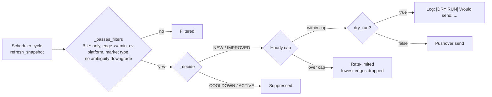
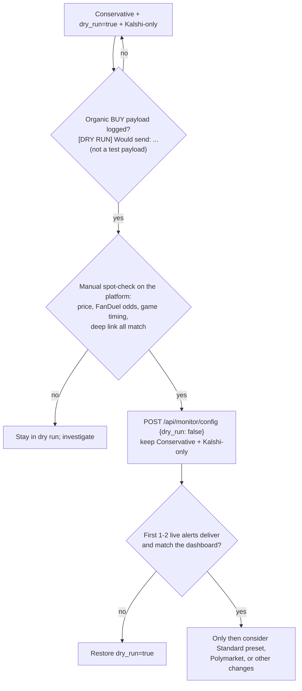

# Operations Reference

Operator reference for running MasG EV Tool locally: environment, defaults,
REST API, configuration, alerting, Odds API budget, and troubleshooting.

All values below are taken from source code. Where a value here and the code
disagree, the code is authoritative; file paths are relative to the
repository root so each statement can be checked.

Related documents:

- [Manual testing runbook](./MANUAL_TESTING_RUNBOOK.md): step-by-step manual
  procedure, BUY verification checklist, red flags.
- [Demo guide](./DEMO_GUIDE.md): offline demo mode (`MASG_DEMO_MODE=1`).

> **Scope reminder.** The tool is read-only decision support. It never places
> orders, signs transactions or holds wallet credentials. Every marketplace
> action is taken manually by the operator. Probabilities shown are
> FanDuel-implied (devigged) model probabilities, i.e. estimates, not
> objectively true probabilities.

---

## Contents

1. [Operating defaults](#1-operating-defaults)
2. [Environment variables](#2-environment-variables)
3. [Running the services](#3-running-the-services)
4. [REST API reference](#4-rest-api-reference)
5. [Engine configuration](#5-engine-configuration)
6. [Supported sports and per-sport overrides](#6-supported-sports-and-per-sport-overrides)
7. [Scan configuration](#7-scan-configuration)
8. [Monitor configuration and alert presets](#8-monitor-configuration-and-alert-presets)
9. [Phone alerts setup](#9-phone-alerts-setup)
10. [Gated go-live procedure](#10-gated-go-live-procedure)
11. [Odds API budget](#11-odds-api-budget)
12. [Troubleshooting and common diagnoses](#12-troubleshooting-and-common-diagnoses)
13. [Known operational caveats](#13-known-operational-caveats)

---

## 1. Operating defaults

| Area | Default | Source |
|---|---|---|
| Books scanned | Kalshi **on**, Polymarket **off** | `_default_platforms()` in `backend/services/scan_config.py` |
| Polymarket | Opt-in per session via the dashboard **Books** toggle or `POST /api/scan/config` | `update_scan_config()` in `backend/services/scan_config.py` |
| Alert platform allowlist | `["kalshi"]` (kept aligned with the scan allowlist) | `MonitorConfig.platforms` in `backend/services/monitor/config.py` |
| Alert market types | `["h2h"]` | `MonitorConfig.market_types` |
| Monitor scheduler | Off until `POST /api/monitor/start` | `MonitorConfig.enabled = False` |
| Monitor dry run | **`dry_run = True`** (payloads are logged, not sent) | `MonitorConfig.dry_run` |
| Monitor preset | `standard` (min EV 5%, 15 min refresh, 30 min cooldown, 10 alerts/hour) | `MonitorConfig.preset` |
| Player props | Disabled (`enable_props = False`); pipeline exists but is gated | `EngineConfig.enable_props` in `backend/services/engine_config.py` |
| Soccer (3-way) without FanDuel draw odds | SKIP via `NO_BOOKMAKER_DATA` (prevents 2-way-devig phantom EV) | `_is_three_way_sport()` and the draw check in `backend/services/feature_extractor.py` |
| Paper maker | Disabled; paper-only, Kalshi-only, H2H-only are enforced | `MakerConfig` in `backend/services/maker/config.py`, `_enforce_safety()` in `backend/routers/maker.py` |

Persistence:

- Scan config, monitor config and maker config are **in memory only**. A
  backend restart restores the defaults above (Kalshi-only, `dry_run=true`,
  Standard preset, maker disabled).
- Alert state (cooldowns, hourly-cap timestamps, alert history) persists in
  `backend/data/alert_state.json`, written atomically
  (`AlertStateStore` in `backend/services/monitor/state.py`).
- Paper maker proposals persist as JSONL under
  `backend/data/maker_paper_orders/` (`PaperMakerStore` in
  `backend/services/maker/state.py`).
- Odds caches (`backend/services/odds_cache.py`, `prop_cache.py`,
  `discovery_cache.py`) are in memory; a restart empties them and the next
  scan re-fetches.

---

## 2. Environment variables

Backend variables are read from `backend/.env` (loaded by `load_dotenv()` in
`backend/main.py`). Copy `backend/.env.example` to `backend/.env` and fill in
values. Never commit `.env` or paste key values into logs, issues or docs.

| Variable | Required | Read by | Effect if unset |
|---|---|---|---|
| `ODDS_API_KEY` | **Yes** for any live scan | `backend/services/odds_provider.py` | `fetch_odds()` raises `ValueError`; `GET /api/opportunities` cold start returns 503. No FanDuel data means no pricing reference. |
| `KALSHI_API_KEY` | **Effectively yes** with default books | `backend/services/adapters/kalshi.py`, `backend/services/monitor/ws_kalshi.py`, `backend/services/price_history.py`, `backend/services/maker/orderbook.py` | `KalshiAdapter.fetch_markets()` returns no markets. Because Kalshi is the only default book, a default scan then produces no opportunities. The Kalshi WebSocket consumer cannot authenticate. |
| `GAMMA_API_BASE` | No | `backend/services/events.py`, `backend/services/price_history.py` | Defaults to the public Polymarket Gamma endpoint. Only used when Polymarket is enabled, for Polymarket price history, and by the legacy `GET /api/odds/matches`. |
| `PUSHOVER_USER_KEY` | Only for live alerts or the credential test | `_get_config()` in `backend/routers/monitor.py` | `has_pushover_credentials=false`; `POST /api/monitor/test` returns 400; `POST /api/monitor/start` with `dry_run=false` returns 400. |
| `PUSHOVER_API_TOKEN` | Only for live alerts or the credential test | same as above | same as above |
| `MASG_DEMO_MODE` | No | `backend/services/demo/__init__.py`; see [DEMO_GUIDE.md](./DEMO_GUIDE.md) | Normal live-data operation. |

Frontend:

| Variable | Default | Read by |
|---|---|---|
| `NEXT_PUBLIC_BACKEND_URL` | `http://localhost:8000` | `frontend/lib/api.ts` |

The backend's allowed browser origins are `http://localhost:3000` and
`http://127.0.0.1:3000` (`ALLOWED_ORIGINS` in `backend/main.py`, used by both
CORS and the origin guard). A frontend served from any other origin gets its
reads blocked by CORS and its state-changing requests rejected with 403.

Credential handling: API keys passed as URL/query parameters (`apiKey`,
`api_key`, `token`, `access_token`, `user`) are redacted from log records and
error strings by `configure_log_redaction()` / `redact_secrets()` in
`backend/services/redaction.py`. Still treat backend logs as sensitive.

---

## 3. Running the services

| Service | Command (from repo root) | Address |
|---|---|---|
| Backend | `cd backend && uvicorn main:app --port 8000` (add `--reload` during development) | `http://127.0.0.1:8000` |
| Frontend | `cd frontend && npm install && npm run dev` | `http://localhost:3000` |
| Both (Windows) | `start-dev.bat` | as above |
| Backend tests | `cd backend && python -m pytest` (config in `backend/pytest.ini`; dev deps in `backend/requirements-dev.txt`) | n/a |

The backend has **no authentication**. Keep it bound to localhost (the
uvicorn default) and do not expose port 8000 to a network.

Cold-start probe:

```bash
curl -s http://localhost:8000/api/opportunities/status
# {"has_snapshot": false, ...}   expected before the first scan
```

---

## 4. REST API reference

All routers are mounted under `/api` (`backend/main.py`). The tables list
every route defined in `backend/routers/*.py`.

Legend for the **Credits** column: **yes** = may call The Odds API and
consume credits (subject to the TTL cache where noted); **no** = reads local
state only. "Kalshi/PM" = calls the prediction-market APIs but not The Odds
API.

### 4.1 Opportunities (`backend/routers/opportunities.py`)

| Method | Path | Purpose | Credits |
|---|---|---|---|
| GET | `/api/opportunities` | Opportunities from the cached snapshot. On cold start (no snapshot) runs the pipeline once (`refresh_snapshot(trigger="cold_start")`). Query: `platform` (view filter), `include_watch` (default `true`; `false` returns BUY only). Sets `X-Odds-Quota-Remaining` header when `meta["quota_remaining"]` is non-empty. | yes, cold start only |
| GET | `/api/opportunities/snapshot` | Read latest snapshot. **Never** triggers the pipeline. 204 if no snapshot exists. Same query params as above. | no |
| GET | `/api/opportunities/status` | Lightweight status: `has_snapshot`, `updated_at`, `is_refreshing`, `refresh_started_at`, `last_refresh_error`, `last_refresh_duration_seconds`, `trigger`, `last_trigger`, `opportunity_count`, `status_counts`, `platforms_fetched`, `odds_failures`, `degraded`. | no |
| POST | `/api/opportunities/refresh` | Start a background pipeline refresh; returns **202** with current status immediately. Body (optional): `{"scope": "stale" \| "all" \| "<odds_api_key>"}`. No-op if a refresh is already running. Does not start or stop the monitor. | yes |
| GET | `/api/opportunities/policy` | The rule policy table (`POLICY_TABLE` in `backend/services/rule_engine.py`). | no |
| GET | `/api/opportunities/history` | Price history for one market (CLV chart). Query: `platform`, `market_id`. | Kalshi/PM |
| GET | `/api/opportunities/historical-odds` | Historical FanDuel odds snapshot at or before a timestamp (CLV backfill). Query: `sport_key`, `event_id`, `date`. Returns `{"snapshot": null}` if unavailable or no key. | yes (historical endpoint, plan-dependent) |
| GET | `/api/opportunities/debug` | Runs a fresh diagnostic pipeline and returns up to 100 candidates' full rule traces, SKIPs included (`pass_b_classification.evaluated` is truncated to 100; `status_counts` covers all candidates), plus `policy_table` and the `config` used. It ignores the scan platform toggles and always fetches both Kalshi and Polymarket (`diagnose_pipeline()` in `backend/services/opportunities.py`). Query overrides: `min_edge`, `wide_market_min_edge`, `survival_threshold`, `buy_threshold` (debug run only; not persisted). | yes |

`scope` details (`refresh_snapshot()` in `backend/services/snapshot.py`):

- `stale` (default): no invalidation; sports within their TTL are served from
  cache. Cheapest.
- `all`: clears the FanDuel odds cache and re-fetches every enabled sport. Use
  sparingly.
- Any other value is passed to `odds_cache.invalidate()`, which is keyed by
  **Odds API sport key** (for example `icehockey_nhl`, `soccer_epl`), not by
  the config key (`hockey_nhl`). A config key that differs from its Odds API
  key (such as `tennis` or `hockey_nhl`) matches nothing and the refresh
  behaves like `stale`.

### 4.2 Scan and data status (`backend/routers/scan.py`)

| Method | Path | Purpose | Credits |
|---|---|---|---|
| GET | `/api/scan/config` | Per-sport scan settings (`enabled`, `odds_ttl_seconds`, `market_types`), per-platform toggles, `global_max_odds_api_per_day`, `odds_cache` state (per Odds API key: `event_count`, `fetched_at`, `age_seconds`, `quota`), and read-only `props_enabled`. | no |
| POST | `/api/scan/config` | Partial update. Examples: `{"platforms": {"polymarket": {"enabled": true}}}`, `{"sports": {"soccer_epl": {"enabled": false}}}`, `{"sports": {"baseball_mlb": {"odds_ttl_seconds": 1800}}}`. Sport keys here are **config keys**. See the typing caveat in [section 13](#13-known-operational-caveats). | no |
| GET | `/api/data-status` | Per-sport, per-book (FanDuel / Polymarket / Kalshi) data matrix: `has_data`, `event_count`, `cache_age_seconds`, and Kalshi `raw_count` (markets returned before normalization). For FanDuel, `event_count` is cached events; for Polymarket/Kalshi it is the number of BUY/WATCH opportunities in the latest snapshot, not the number of normalized markets (`get_data_status()`). | no |
| GET | `/api/sports` | Static registry of **enabled** sports (`key`, `label`, `match_style`, `market_types`). | no |

### 4.3 Monitor and alerts (`backend/routers/monitor.py`)

| Method | Path | Purpose | Credits |
|---|---|---|---|
| GET | `/api/monitor/config` | Current alert settings, including `dry_run` and `has_pushover_credentials` (credential values are never returned). | no |
| POST | `/api/monitor/config` | Update settings. **Does not start or stop** the scheduler. Accepted fields: `preset`, `min_ev`, `platforms`, `market_types`, `cooldown_minutes`, `max_alerts_per_hour`, `refresh_interval_minutes`, `dry_run`, `pushover_user_key`, `pushover_api_token`. Setting any field without `preset` relabels the preset as `custom`. Unknown fields are ignored. | no |
| POST | `/api/monitor/start` | Start the scheduler (stops an existing loop first). Runs one pipeline cycle immediately, then the Odds API poller and WebSocket consumers for the platforms in `MonitorConfig.platforms`. Returns 400 if `dry_run=false` and Pushover credentials are missing. The call returns after the startup cycle completes. | yes |
| POST | `/api/monitor/stop` | Stop the scheduler and persist alert state. | no |
| GET | `/api/monitor/status` | `running`, `enabled`, `last_cycle_ts`, `total_cycles`, `total_alerts_sent`, `odds_poller` (polls today, remaining, interval, next poll), `polymarket_ws`, `kalshi_ws`, `last_cycle_result`. | no |
| GET | `/api/monitor/history` | Up to 50 recent alert-state records. | no |
| POST | `/api/monitor/test` | **Sends a REAL Pushover notification and bypasses `dry_run` by design.** Credential/delivery verification only. Does not start the scheduler or change config. Optional body `{"message": "..."}`. Do not call unless a real phone notification is intended. | no |

### 4.4 Paper maker (`backend/routers/maker.py`)

Paper-only simulated proposal records. There is no order placement endpoint.

| Method | Path | Purpose | Credits |
|---|---|---|---|
| GET | `/api/maker/proposals` | Recent paper proposals, newest first. Query: `days` (1-90, default 1), `status`, `eligible`, `platform`, `market_id`, `latest_run`, `limit` (1-1000, default 100). Empty store returns an empty list. | no |
| GET | `/api/maker/summary` | Aggregate counts, top rejection reasons and near-miss diagnostics. Query: `days`, `top_n`, `latest_run`. | no |
| GET | `/api/maker/config` | Current runtime maker config. | no |
| POST | `/api/maker/config` | Update safe fields only (`enabled`, thresholds and paper limits). `paper_only=True`, `platforms=["kalshi"]`, `market_types=["h2h"]` are re-enforced on every update; non-finite and negative values are rejected. | no |

### 4.5 Legacy odds endpoints (`backend/routers/odds.py`)

**Legacy, tennis-only debug surface.** Not used by the dashboard. Uses the
older matcher in `backend/services/matcher.py`, not the Pass A / Pass B
pipeline, so its matches are not policy-evaluated. Calls The Odds API
directly **without** the TTL cache, so every request spends credits.

| Method | Path | Purpose | Credits |
|---|---|---|---|
| GET | `/api/odds/tennis` | Normalized H2H tennis odds. Query: `max_sports` (1-30, default 10; one request per tennis key). | yes, uncached |
| GET | `/api/odds/matches` | Cross-matches tennis odds against Polymarket tennis markets. Query: `max_sports`, `min_confidence` (default `MIN_CONFIDENCE = 0.90`). | yes, uncached |

---

## 5. Engine configuration

`EngineConfig` in `backend/services/engine_config.py` holds the global
thresholds. Pass B rules in `backend/services/rule_engine.py` read them; three
of them are overridden per sport (see [section 6](#6-supported-sports-and-per-sport-overrides)).

| Field | Default | Used for |
|---|---|---|
| `min_edge` | `0.05` | BUY edge threshold **fallback** when no `SportConfig` matches the candidate's sport (`_edge_meets_threshold`). Matched sports use `SportConfig.min_edge`. |
| `wide_market_min_edge` | `0.08` | BUY edge threshold when FanDuel line width exceeds `max_line_width_for_normal_threshold`. Applies regardless of sport. |
| `max_line_width_for_normal_threshold` | `0.35` | Line-width cutoff for the wide-market threshold. |
| `min_true_probability` | `0.40` | `TRUE_PROB_TOO_LOW` (CRITICAL) below this model probability. |
| `survival_threshold` | `0.85` | `CONFIDENCE_BELOW_SURVIVAL` (CRITICAL) below this match confidence. |
| `buy_threshold` | `0.90` | `CONFIDENCE_BELOW_BUY` (DOWNGRADE) between survival and buy thresholds. |
| `overround_high_max` / `overround_medium_max` | `0.03` / `0.06` | FanDuel confidence tiers (High / Medium / Low) by overround; a `Wide` line (width > 0.35) drops one tier (`_fd_confidence_label()` in `backend/services/feature_extractor.py`). Low triggers `FD_CONFIDENCE_LOW` (DOWNGRADE). |
| `kelly_cap` | `0.25` | Cap on full-Kelly fraction. |
| `kelly_fraction` | `0.20` | Fractional Kelly multiplier (1/5 Kelly). |
| `cost_buffer` | `0.01` | Added to entry price for Kalshi; Polymarket uses `0.0` (`_cost_buffer()` in `backend/services/feature_extractor.py`). |
| `min_price` / `max_price` | `0.02` / `0.98` | `PRICE_OUT_OF_RANGE` (CRITICAL) outside this range. |
| `min_name_length` | `3` | Last names shorter than this are ignored for matching. |
| `min_confidence_gap` | `0.05` | `AMBIGUOUS_MATCH_GAP` (DOWNGRADE) when best and second-best match are closer than this. |
| `max_competing_matches` | `1` | `EXCESS_COMPETING_MATCHES` (DOWNGRADE) above this. |
| `max_price_prob_divergence` | `0.40` | `PRICE_PROB_DIVERGENCE` (CRITICAL): likely side inversion. |
| `max_date_delta_hours` | `72.0` | `DATE_TOO_FAR` (CRITICAL) fallback; overridden per sport. |
| `max_plausible_edge` | `0.20` | `EDGE_IMPLAUSIBLE` (DOWNGRADE) fallback; overridden per sport. |
| `require_end_date` | `False` | If true, missing end date triggers `INCOMPLETE_METADATA`. |
| `enable_props` | `False` | Player-prop pipeline gate. Code-level flag; not settable through the API. |
| `max_props_per_event` | `20` | Cap on prop features per game. |

Edge is computed as `p_true - effective_market_price`, where
`effective_market_price = market price + cost buffer` and `p_true` is the
FanDuel-implied (devigged) model probability (`backend/services/devig.py`,
`backend/services/feature_extractor.py`).

Classification (`evaluate_rules` in `backend/services/rule_engine.py`):

- **BUY**: every rule passes.
- **WATCH**: at least one DOWNGRADE rule fails, no CRITICAL failures.
- **SKIP**: at least one CRITICAL rule fails.

The full rule list with stage, severity and reason code is served by
`GET /api/opportunities/policy`.

> Changing thresholds, devig math, the edge formula, cost buffer or Kelly
> parameters changes what is labelled BUY. Do not change them without explicit
> approval and updated tests.

Note on the monitor: scheduler cycles build their own `EngineConfig` with
`min_edge = MonitorConfig.min_ev * 0.5` (`_run_pipeline_and_alert()` in
`backend/services/monitor/scheduler.py`). Because matched sports use
`SportConfig.min_edge`, this mainly affects the unmatched-sport fallback; the
alert-side `min_ev` filter is what limits which BUYs are sent.

---

## 6. Supported sports and per-sport overrides

Source of truth: `SPORTS` in `backend/services/sports_config.py`. Disabled
sports are excluded from the registry helpers that use `_enabled()` (Kalshi
series, PM tags, explicit Odds API keys, props), from Odds API key resolution,
from the default scan config and from `GET /api/sports`.
`config_for_odds_key()` is the exception: it searches all of `SPORTS`,
including disabled entries.

`SportConfig` defaults: `enabled=True`, `market_types=["h2h"]`,
`match_style="individual"`, `min_edge=0.05`, `max_plausible_edge=0.20`,
`max_date_delta_hours=72.0`, `enable_discovery=False`.

| Config key | Label | Enabled | Odds API key(s) | Kalshi series | Market types | Match style | `min_edge` | `max_plausible_edge` | `max_date_delta_hours` |
|---|---|---|---|---|---|---|---|---|---|
| `tennis` | Tennis | yes | group `Tennis` (discovered) | `KXATPMATCH`, `KXWTAMATCH` | h2h | individual | 0.05 | 0.25 | 72 |
| `mma` | UFC/MMA | yes | `mma_mixed_martial_arts` | `KXUFCFIGHT` | h2h | individual | 0.05 | 0.25 | 72 |
| `basketball_nba` | NBA | yes | `basketball_nba` | `KXNBAGAME` | h2h, totals | team | **0.03** | 0.12 | 12 |
| `basketball_wnba` | WNBA | yes | `basketball_wnba` | `KXWNBAGAME` | h2h | team | 0.05 | 0.15 | 12 |
| `baseball_mlb` | MLB | yes | `baseball_mlb` | `KXMLBGAME` | h2h, totals | team | **0.03** | 0.15 | 12 |
| `baseball_kbo` | KBO | yes | `baseball_kbo` | `KXKBOGAME` | h2h | team | 0.05 | 0.20 | 12 |
| `hockey_nhl` | NHL | yes | `icehockey_nhl` | `KXNHLGAME` | h2h, totals | team | **0.03** | 0.12 | 12 |
| `football_nfl` | NFL | yes | `americanfootball_nfl` | `KXNFLGAME` | h2h | team | 0.05 | 0.12 | 12 |
| `ufl` | UFL | yes | `americanfootball_ufl` | `KXUFLGAME` | h2h | team | 0.05 | 0.20 | 12 |
| `soccer_mls` | MLS | yes | `soccer_usa_mls` | `KXMLSGAME` | h2h (3-way) | team | 0.05 | 0.15 | 12 |
| `soccer_epl` | EPL | yes | `soccer_epl` | `KXEPLGAME` | h2h (3-way) | team | 0.05 | 0.15 | 12 |
| `soccer_germany` | Bundesliga | yes | `soccer_germany_bundesliga` | `KXBUNDESLIGAGAME` | h2h (3-way) | team | 0.05 | 0.15 | 12 |
| `soccer_spain` | La Liga | yes | `soccer_spain_la_liga` | `KXLALIGAGAME` | h2h (3-way) | team | 0.05 | 0.15 | 12 |
| `soccer_italy` | Serie A | yes | `soccer_italy_serie_a` | `KXSERIEAGAME` | h2h (3-way) | team | 0.05 | 0.15 | 12 |
| `soccer_france` | Ligue 1 | yes | `soccer_france_ligue_one` | `KXLIGUE1GAME` | h2h (3-way) | team | 0.05 | 0.15 | 12 |
| `soccer_ucl` | Champions League | yes | `soccer_uefa_champs_league` | `KXUCLGAME` | h2h (3-way) | team | 0.05 | 0.15 | 12 |
| `cricket_ipl` | Cricket IPL | **no** | `cricket_ipl` | `KXIPLGAME` | h2h | team | 0.05 | 0.20 | 12 |
| `rugby_nrl` | Rugby NRL | **no** | `rugbyleague_nrl` | `KXRUGBYNRLMATCH` | h2h | team | 0.05 | 0.20 | 12 |
| `hockey_ahl` | Hockey AHL | **no** | `icehockey_ahl` | `KXAHLGAME` | h2h | team | 0.05 | 0.15 | 12 |
| `afl` | AFL | **no** | `aussierules_afl` | `KXAFLGAME` | h2h | team | 0.05 | 0.20 | 12 |

Notes:

- Disabled sports are commented in code as "FanDuel has events but no
  bookmaker lines".
- `enable_discovery=True` for NBA, MLB, NHL and NFL: configured market types
  are validated against FanDuel availability (see [section 11](#11-odds-api-budget)
  for the credit impact).
- `prop_markets` are configured for NBA, MLB and NFL but are only fetched when
  `EngineConfig.enable_props` is true.
- Per-sport rules resolve the sport through `config_for_odds_key()` (exact
  Odds API key, then group prefix such as `tennis_*`). If no config matches,
  the `EngineConfig` fallbacks apply.
- Availability on a given day depends on FanDuel publishing odds through The
  Odds API and on the platform listing a matching market.
- Soccer guard: soccer candidates with no FanDuel `Draw` price are SKIPped as
  `NO_BOOKMAKER_DATA`. This is a safety guard, not a setting. To extend it to
  another 3-way sport, add that sport to `_is_three_way_sport()`; do not remove
  the check.

To add a sport, add a `SportConfig` entry in `backend/services/sports_config.py`
and add adversarial matching tests under `backend/tests/` (same-name
collisions, series ambiguity, 3-way handling) before enabling it.

---

## 7. Scan configuration

`ScanConfig` in `backend/services/scan_config.py`, edited via
`POST /api/scan/config` or the dashboard Books toggles.

| Field | Default | Notes |
|---|---|---|
| `platforms.kalshi.enabled` | `true` | |
| `platforms.polymarket.enabled` | `false` | When enabled, refresh time grows because of CLOB order-book hydration. Re-disable after the session. |
| `sports.<config_key>.enabled` | `true` for every enabled `SportConfig` | Disabled sports are not fetched. |
| `sports.<config_key>.odds_ttl_seconds` | `900` | FanDuel odds cache TTL per sport; main budget lever. |
| `sports.<config_key>.market_types` | from `SportConfig.market_types` | |
| `global_max_odds_api_per_day` | `200` | Stored and displayed only. **Not enforced** by any fetch path in the current code. |

Keep `MonitorConfig.platforms` aligned with the enabled scan platforms. If
Polymarket is enabled for scanning and alerts are wanted for it, add it to
both; never enable it in alerts alone.

---

## 8. Monitor configuration and alert presets

`MonitorConfig` in `backend/services/monitor/config.py`:

| Field | Default | API-settable | Notes |
|---|---|---|---|
| `enabled` | `False` | via start/stop | |
| `preset` | `standard` | yes | |
| `min_ev` | `0.05` | yes | Alert-side edge floor. |
| `platforms` | `["kalshi"]` | yes | Alert allowlist. |
| `market_types` | `["h2h"]` | yes | |
| `exclude_ambiguity_downgraded` | `True` | no | Excludes candidates with `AMBIGUOUS_MATCH_GAP`, `SHARED_LAST_NAME`, `EXCESS_COMPETING_MATCHES` or `LAST_NAME_COLLISION`. |
| `cooldown_minutes` | `30` | yes | Per-opportunity cooldown. |
| `resend_edge_improvement` | `0.03` | no | Edge gain that breaks through cooldown (`IMPROVED`). |
| `max_alerts_per_hour` | `10` | yes | Rolling-hour cap; clamped so a lowered cap never sends extra alerts. |
| `refresh_interval_minutes` | `15` | yes | Odds API poller cadence. |
| `odds_api_max_polls_per_day` | `20` | **no** | Poller daily guard (rolling 24h). Not in `MonitorConfigRequest`, so it cannot be changed through the API. |
| `priority_high_min_edge` | `0.10` | no | Edge at or above this sends Pushover priority 1. |
| `dry_run` | **`True`** | yes | Fail-closed: a restart always returns to dry run. |

Presets (`PRESETS` in the same file):

| Preset | `min_ev` | `refresh_interval_minutes` | `cooldown_minutes` | `max_alerts_per_hour` |
|---|---|---|---|---|
| `conservative` | 0.08 | 30 | 60 | 5 |
| `standard` (default) | 0.05 | 15 | 30 | 10 |
| `aggressive` | 0.03 | 10 | 15 | 20 |
| `custom` | whatever was last set | | | |

Applying a preset changes only those four fields; it does not change
`dry_run` or `platforms`.

Alert flow (`AlertManager` in `backend/services/monitor/manager.py`):



- WATCH and SKIP never alert.
- If a refresh fails, no alerts are dispatched for that cycle (no alerting
  from a stale snapshot).
- Cycle triggers: startup, each Odds API poll, and WebSocket price changes on
  watched markets (at most one WS-triggered evaluation per 10 seconds).
- Dry-run sends also count toward the rolling hourly cap and set cooldown
  records (`_mark_alerted()` runs on any successful send, including
  `DryRunNotifier`).

---

## 9. Phone alerts setup

1. Create a Pushover account, install the app, and create an application
   token.
2. Put `PUSHOVER_USER_KEY` and `PUSHOVER_API_TOKEN` in `backend/.env` and
   restart the backend. Prefer `.env` over sending credentials through
   `POST /api/monitor/config`.
3. In the dashboard **Phone Alerts** panel (or via API), apply the
   **Conservative** preset, keep `platforms=["kalshi"]`, and confirm
   `dry_run=true`:

   ```bash
   curl -X POST -H "Content-Type: application/json" \
     -d '{"preset":"conservative","dry_run":true,"platforms":["kalshi"]}' \
     http://localhost:8000/api/monitor/config
   curl -s http://localhost:8000/api/monitor/config
   ```

4. Optional credential check. This sends **one real notification** regardless
   of `dry_run`; call it only when you want a notification on your phone:

   ```bash
   curl -X POST http://localhost:8000/api/monitor/test
   # {"sent": true}
   ```

5. Start monitoring in dry run, inspect, then stop:

   ```bash
   curl -X POST http://localhost:8000/api/monitor/start
   curl -s http://localhost:8000/api/monitor/status
   curl -s http://localhost:8000/api/monitor/history
   curl -X POST http://localhost:8000/api/monitor/stop
   ```

Dry-run payloads appear in the backend log as
`[DRY RUN] Would send: ...`, followed by an `AlertManager cycle: ...` summary
line (evaluated, passed filters, sent, cooldown, rate-limited, filtered).

Payload contents (`format_instant_alert()` in
`backend/services/monitor/notifier.py`): edge, side, event, platform and
market type, price, model probability, FanDuel odds and confidence, Kelly,
and a platform link (Kalshi uses its web URL).

---

## 10. Gated go-live procedure

Live alerts (`dry_run=false`) stay off until every gate below has passed.



1. Run Conservative dry run across a window where Kalshi has active markets.
   Wait for at least one **organic** BUY payload in the backend log.
2. Spot-check every flagged BUY on the platform: price, FanDuel odds, game
   time, and the link in the payload.
3. Only then: `POST /api/monitor/config {"dry_run": false}` while keeping
   Conservative and `platforms=["kalshi"]`.
4. Verify the first one or two live alerts arrive and match the dashboard.
5. Only after that consider the Standard preset, Polymarket, or relaxed
   thresholds, each as a separate step.

Limited live window (bounded test of the live path):

1. Pre-flight: `GET /api/monitor/status` shows `running=false`;
   `GET /api/monitor/config` shows `has_pushover_credentials=true`;
   `GET /api/scan/config` shows Polymarket disabled.
2. Apply `{"preset":"conservative","dry_run":false,"platforms":["kalshi"],"max_alerts_per_hour":2}`.
3. `POST /api/monitor/start`; watch the log for `Pushover: sent` and errors.
4. Afterwards, `POST /api/monitor/stop` and restore
   `{"preset":"conservative","dry_run":true,"platforms":["kalshi"],"max_alerts_per_hour":5}`.

Do not, without explicit approval:

- set `dry_run=false` before gate 1 has passed;
- disable the BUY-only filter, ambiguity exclusion or cooldown;
- raise `max_alerts_per_hour` above 5 while on Conservative;
- add Polymarket to `MonitorConfig.platforms` without enabling it in
  `ScanConfig` (and vice versa for alerts);
- call `POST /api/monitor/test` casually.

A live alert is a prompt for manual review, not an instruction. Apply the
verification checklist in the [runbook](./MANUAL_TESTING_RUNBOOK.md) before
any marketplace action.

---

## 11. Odds API budget

Check your plan's monthly quota with the provider; `backend/.env.example`
notes the free tier as 500 requests per month. The remaining balance reported
by the API is surfaced as `quota_remaining` in the snapshot, the
`X-Odds-Quota-Remaining` response header, the dashboard toolbar, and
per-key `quota` in `GET /api/scan/config` → `odds_cache`.

### What consumes credits

| Source | Code | When |
|---|---|---|
| Per-sport odds fetch | `_fetch_sport_odds()` in `backend/services/odds_provider.py` | Once per enabled Odds API key whose cache entry is older than `odds_ttl_seconds`. The code estimates `len(market_types)` credits per call. |
| Tennis key discovery | `_resolve_all_sport_keys()` | `GET /v4/sports` at most once per hour (cached; stale cache served on error). The code makes no credit estimate for this call; see the provider's documentation. Each active tennis tournament key is then fetched like any other sport. |
| Market discovery | `discover_sport_markets()` | NBA, MLB, NHL, NFL; at most once per 4 hours per sport (`discovery_cache`). |
| Alternate-line sampling | `_sample_alternate_lines()` | NBA, MLB, NHL, NFL, after **every** fresh fetch of that sport. Logging only; its output is not used for pricing. |
| Player props | `fetch_props()` | Only when `enable_props=True` (default off). Per-event requests. |
| Historical odds (CLV) | `fetch_historical_odds()` via `GET /api/opportunities/historical-odds` | Each CLV backfill request from tracked positions calls the historical endpoint with the same API key. Historical access and its per-request cost depend on the plan; check the provider's pricing. |
| Legacy endpoints | `/api/odds/tennis`, `/api/odds/matches` | Every call; no cache. |
| Debug pipeline | `GET /api/opportunities/debug` | Each call runs a fresh pipeline (TTL cache still applies). |

With the current registry, a full re-fetch of every enabled sport is
approximately 18 credits by the code's own estimate (15 explicit keys, three
of which request h2h and totals) plus one per active tennis key, plus
alternate-line sampling for NBA/MLB/NHL/NFL. `fetch_odds()` fetches at most
25 Odds API keys per run (`max_sports=25`); explicit keys come first, so at
most 10 tennis tournament keys are fetched. The provider's reported usage is
authoritative.

What triggers a fetch:

- `POST /api/opportunities/refresh` (`stale` fetches only expired sports; `all`
  fetches everything).
- Cold-start `GET /api/opportunities`.
- Every monitor cycle: startup, each poller tick, and WebSocket-triggered
  re-evaluations.

Pipeline runs (startup, poller-triggered, WebSocket-triggered, manual refresh,
cold start) share the snapshot `_refresh_lock` (`backend/services/snapshot.py`)
and do not overlap. The poller's own `fetch_odds()` call
(`OddsApiPoller.poll_once()` in `backend/services/monitor/odds_poller.py`)
happens outside that lock and can overlap a manual or WebSocket-triggered
refresh.

The daily poll guard (`odds_api_max_polls_per_day`, default 20) only gates the
poller's own `fetch_odds()` call. When it is exhausted the poller still invokes
the pipeline with its last events, and WebSocket triggers also run the
pipeline; those runs re-fetch any sport whose TTL has expired. In practice the
TTL and the refresh interval are the effective spend controls, not the poll
guard or `global_max_odds_api_per_day`.

### Levers

| Goal | Action |
|---|---|
| Stop fetching a sport you do not use | `POST /api/scan/config {"sports": {"<config_key>": {"enabled": false}}}` |
| Re-use odds longer | `POST /api/scan/config {"sports": {"<config_key>": {"odds_ttl_seconds": 1800}}}` (integer; default 900) |
| Slow the monitor | Conservative preset (30 min) or `POST /api/monitor/config {"refresh_interval_minutes": 30}` |
| Avoid unnecessary full refreshes | Use `scope: "stale"` (default); reserve `"all"` for when fresh odds are required |
| Avoid repeated expensive calls | Do not poll `/api/odds/*` (uncached) or `/api/opportunities/debug` (runs a full pipeline) in loops |
| Keep the monitor off when not needed | `POST /api/monitor/stop` |

Monitor cadence and cache TTL interact: with the default 900 s TTL and a
cadence of 15 minutes or less, nearly every cycle re-fetches every enabled
sport. Raising the TTL above the cadence is the most direct way to reduce
spend.

---

## 12. Troubleshooting and common diagnoses

### Status and data checks

```bash
curl -s http://localhost:8000/api/opportunities/status   # refresh state, errors, degraded
curl -s http://localhost:8000/api/data-status            # per-sport, per-book matrix
curl -s http://localhost:8000/api/scan/config            # books, sports, TTLs, cache ages
curl -s http://localhost:8000/api/monitor/status         # scheduler, poller, WS state
```

| Symptom | Likely cause | Check / action |
|---|---|---|
| `GET /api/opportunities` returns 503 | `ODDS_API_KEY` unset | Set it in `backend/.env` and restart. |
| Scan completes with zero opportunities on default settings | `KALSHI_API_KEY` unset (Kalshi adapter skips) or Polymarket off by design | Set the key, then check `GET /api/data-status` (Kalshi `raw_count`) or the `KalshiAdapter: N raw markets` log line. `platforms_fetched` only shows which adapters were enabled, not whether they returned data. |
| `degraded: true` / non-empty `odds_failures` in `/status` | One or more Odds API keys failed to refresh (for example `HTTP 401`, `HTTP 429`) | Expired odds for those keys are evicted, so those sports are absent rather than priced on stale data. Check quota and key validity; the next refresh retries. |
| `last_refresh_error` is set | Pipeline raised during refresh | The previous snapshot is kept. Read the backend log (keys are redacted). |
| Sport shows FanDuel `event_count = 0` | Off-season, FanDuel not publishing, sport disabled, or fetch failure | No pricing reference means no opportunities for that sport. Check `enabled` in `sports_config.py` and scan config. |
| Kalshi `raw_count > 0` but `event_count = 0` | Kalshi markets were fetched but produced no BUY/WATCH rows: they were not normalized (for example draw/Tie legs), did not match a FanDuel event, or were all SKIPped | Compare the `[KALSHI] <series> → raw: N, normalized: M` log line and use `GET /api/opportunities/debug`. |
| Soccer rows missing | FanDuel did not publish draw odds, so candidates are SKIPped (`NO_BOOKMAKER_DATA`) and SKIPs are not shown | Correct behaviour; do not bypass. Confirm in `GET /api/opportunities/debug`. |
| Monitor running but no WS re-evaluations | Kalshi WS auth rejected (401/403 stops reconnecting) or WS disconnected (exponential backoff 5 s to 60 s) | `GET /api/monitor/status` → `kalshi_ws`; check `KALSHI_API_KEY`; restart the monitor after fixing. |
| Poller shows `polls_remaining: 0` | Daily guard exhausted (rolling 24h) | See [section 11](#11-odds-api-budget); pipeline runs continue on TTL. |
| Alerts suppressed right after switching from dry run to live | Dry-run sends counted toward the rolling hourly cap and set per-opportunity cooldowns | Cap self-clears within an hour; cooldowns expire after `cooldown_minutes` unless the edge improves by `resend_edge_improvement`. |
| `POST /api/monitor/start` returns 400 | `dry_run=false` without Pushover credentials | Add credentials or set `dry_run=true`. |
| Refresh with `scope: "<sport>"` did not refresh odds | Scope must be the Odds API key | Use for example `icehockey_nhl`, or `all`. |
| Dashboard shows outage or stale-data banner | Backend unreachable or snapshot old | Confirm uvicorn is running on port 8000 and `NEXT_PUBLIC_BACKEND_URL` is correct; re-scan. |

### Why is a row WATCH, SKIP or BUY?

Dashboard and snapshot rows are BUY or WATCH only: `fetch_opportunities()` in
`backend/services/opportunities.py` drops SKIPs before the snapshot is built.
For a BUY or WATCH row, use `downgrade_reasons` and `rule_evaluations` on the
row (also shown in the dashboard detail panel). SKIP candidates and their
`reject_reasons` are visible only through `GET /api/opportunities/debug`,
subject to its 100-candidate cap.

- **WATCH** (`downgrade_reasons`): most often `EDGE_BELOW_THRESHOLD`,
  `FD_CONFIDENCE_LOW`, `EDGE_IMPLAUSIBLE`, `CONFIDENCE_BELOW_BUY`, or one of the
  ambiguity rules (`AMBIGUOUS_MATCH_GAP`, `SHARED_LAST_NAME`,
  `EXCESS_COMPETING_MATCHES`, `LAST_NAME_COLLISION`).
- **SKIP** (`reject_reasons`, debug endpoint only): most often `NO_EDGE`, `NAME_MISMATCH`,
  `OUTCOME_NOT_ALIGNED`, `CONFIDENCE_BELOW_SURVIVAL`, `DATE_TOO_FAR`,
  `PRICE_PROB_DIVERGENCE`, `EVENT_LIVE`, `NO_BOOKMAKER_DATA`.
- **BUY that looks wrong**: inspect `home_tokens`, `away_tokens`,
  `name_match_score`, `event_match_confidence`, `date_delta_hours`,
  `competing_matches`, `confidence_gap`. A BUY with any entry in
  `downgrade_reasons` or `reject_reasons` indicates a bug. Treat unusually
  large edges as suspected data errors until verified.

Useful debug slices (`jq`):

```bash
curl -s http://localhost:8000/api/opportunities/debug > debug.json
jq '.pass_b_classification.status_counts' debug.json
jq '.stage_1_fetch' debug.json
jq '.pass_b_classification.evaluated[] | select(.event | contains("<team>"))' debug.json
```

Re-scan immediately before verifying any BUY: platform prices move after the
snapshot (`price_fetched_at` records capture time).

---

## 13. Known operational caveats

Open items from the engineering audit that affect day-to-day operation. They
are documented here, not fixed.

- **No authentication.** `OriginGuardMiddleware`
  (`backend/services/origin_guard.py`) rejects state-changing requests
  (anything other than GET/HEAD/OPTIONS) from a foreign browser `Origin`,
  including `Origin: null`, with 403. Requests with no `Origin` header (curl,
  scripts, local processes) are allowed, so keep the backend on localhost.
  GET endpoints that spend credits are not covered by the guard
  (`GET /api/opportunities/debug`, `/api/opportunities/historical-odds`,
  `/api/odds/*`, cold-start `GET /api/opportunities`), so a cross-site page
  can still trigger them.
- **`POST /api/scan/config` is untyped.** Values are applied with `setattr`
  and no schema. Send JSON booleans and integers (`true`, `1800`), never
  strings (`"false"`, `"1800"`); a string TTL breaks later refreshes and a
  string `"false"` is truthy.
- **Refresh scope by config key** does not invalidate odds when the config key
  differs from the Odds API key (see [section 4.1](#41-opportunities-backendroutersopportunitiespy)).
- **Budget guards** (`odds_api_max_polls_per_day`,
  `global_max_odds_api_per_day`) do not bound actual credit spend (see
  [section 11](#11-odds-api-budget)).
- **Alternate-line sampling** spends credits on every fresh NBA/MLB/NHL/NFL
  fetch for logging only.
- **No 429 / Retry-After handling.** A failing sport is retried on the next
  pipeline run.
- **Alert state grows over time.** `AlertStateStore.prune_stale()` exists but
  is not scheduled.
- **No shutdown hook.** The app defines no lifespan handler, so monitor tasks
  are not cancelled cleanly on shutdown. Alert state is saved after every
  alert cycle, but prefer `POST /api/monitor/stop` before stopping uvicorn.
- **Polymarket alert links** are built from the market id rather than the
  event slug and may not open the right page. Polymarket alerts are off by
  default; verify the link manually if they are enabled.
- **Kalshi 429s** can occur for individual series during long polling
  windows; affected series are skipped for that scan while the rest proceed.
